# SatHunterSDR


A satellite-hunting SDR receiver for Android: pick a satellite, the app tunes to it and follows
its Doppler shift, and a sky radar turns with your phone so you can point the antenna.
Made for classrooms first: it runs without hardware (a simulated RTL-SDR with a simulated pass),
and decoders are small plugins that students can write. Tested end to end, in the field and in the
lab, with the [Spacewalker LNA 434 MHz](docs/LNA-CHARACTERISATION.md) and an RTL-SDR Blog V3.

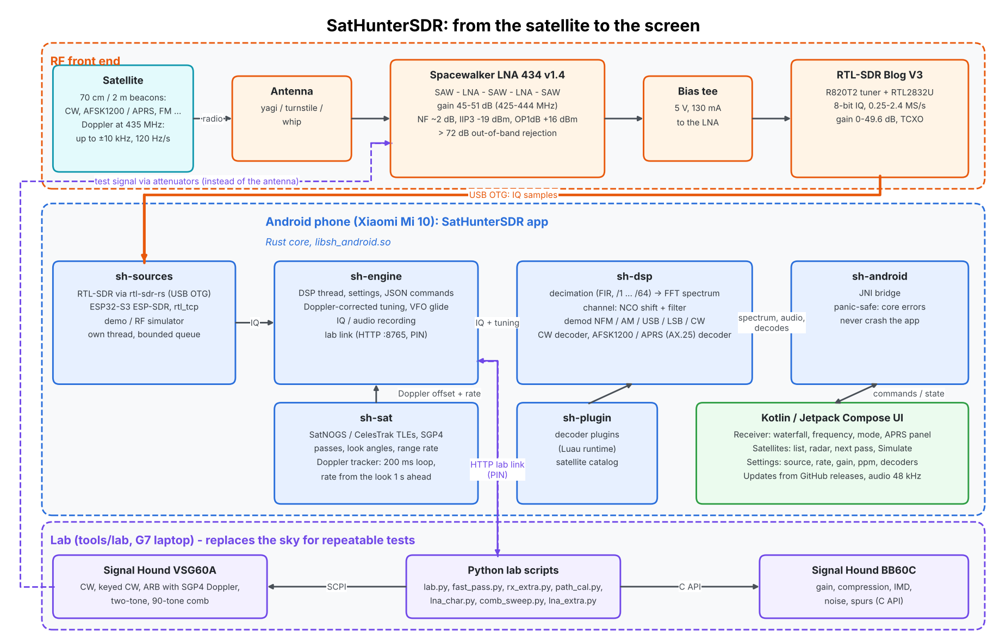

From the satellite to the screen: the RF front end, the Rust core (sources, engine, DSP, orbits, plugins),
the Android UI, and the lab instruments that replace the sky for repeatable tests
([docs/ARCHITECTURE.md](docs/ARCHITECTURE.md)).

**Summary for engineers** (3 pages: bugs found and fixed, lab and field results):
[docs/report/SatHunterSDR-lab-field-summary.pdf](docs/report/SatHunterSDR-lab-field-summary.pdf)

## Features (0.2 beta)

- **Satellites**: SatNOGS DB and CelesTrak data, pass prediction (SGP4, checked against Skyfield and an independent SGP4 to 0.16 Hz of Doppler), filters by band, mode, status; favourites first, "Next pass" or "Best heard" (SatNOGS reception) order.
- **Doppler tracking**: tunes to the selected downlink and follows it, gliding between updates (±9 Hz at 116 Hz/s). Your own retuning is kept as an offset (linear transponders).
- **Radar**: the whole pass with AOS/LOS times, the satellite, others overhead. A compass mode follows the phone; aim mode guides you to the satellite.
- **Receiver**: GPU spectrum and waterfall, NFM / WFM / AM / USB / LSB / CW, pinch zoom, drag to tune, full-screen mode with floating controls that fade away; satellite labels on the waterfall at their Doppler-shifted frequency.
- **Decoders**: CW, APRS / AX.25 (AFSK1200, three merged detectors) with a frame list, 9600 bd G3RUH FSK telemetry (AX.25 and other HDLC frames), SSTV (Robot 36, PD120), Luau decoder plugins; checked in CI on real SatNOGS recordings.
- **World map** (offline): your station, the satellite's footprint and ground track, the APRS stations heard, with distances.
- **Terrestrial APRS mode** (Settings): the local APRS network on 144.800 MHz (or 144.390 / 145.175 ...), tracking off, every station on the map; for testing the decoder and the map on the ground.
- **SDRs**: RTL-SDR (bias tee, ppm correction) and ESP32-S3 (ESP-SDR firmware, 2204–2804 MHz, smooth in-stream tuning), plug and play over USB OTG.
- **IQ recorder**: SDR++ compatible WAV with the receiver settings and the satellite inside.
- **Updates**: the app finds new GitHub releases and installs them.
- **Demo source**: FM broadcast, airband, APRS, a CW beacon, ISM bursts and the selected satellite at its real Doppler frequency, with "Simulate this pass now".
- **Lab link**: a LAN API that turns the phone into a measuring receiver for scripts ([docs/LAB.md](docs/LAB.md)).

Coming next: GMSK with sync words / RS and satellite-specific telemetry plugins, the ESP-SDR wideband spectrum mode and firmware updater, rtl_tcp, more sources.

## Results at a glance

Chain: Spacewalker LNA 434 MHz -> RTL-SDR Blog V3 -> SatHunterSDR on a Xiaomi Mi 10. Every lab run has a report,
plots and raw data in [measurements/](measurements/README.md); field notes are in [docs/MEASUREMENTS.md](docs/MEASUREMENTS.md).

| | Quantity | Result |
|---|---|---|
| Field | ITUPSAT 1, 70 cm CW, 19° pass, 6-element yagi | callsign decoded at 12 WPM, C/N0 ~41 dB-Hz, Doppler tracked |
| Field | CUBEBUG-2, AFSK1200, IQ recording | 3 of 5 frames with a good CRC, C/N0 ~55 dB-Hz |
| Lab | System noise figure at 436.6 MHz | 2.0 dB |
| Lab | Sensitivity (MDS, 3 dB SNR in 31 Hz) | -154.4 dBm |
| Lab | Keyed CW at 15 WPM | decoded down to -145 dBm (C/N0 29 dB-Hz) |
| Lab | APRS (AFSK1200) | 90 % packets at -122.5 dBm (3 kHz dev.), -123.2 dBm (1 kHz dev., 6 kHz channel) |
| Lab | SSTV Robot 36 / PD120 | clean to -132 dBm, recognisable to -136 dBm ([lab15](measurements/2026-11-06_0941_sstv-robot36-lab15/report.md)); PD120 decoded at -134 dBm ([report](measurements/2026-11-06_0832_sstv-pd120/report.md)) |
| Lab (home, HackRF) | 9600 bd G3RUH | 90 % frames at about -114.8 dBm ([report](measurements/2026-11-07_1829_g3ruh-hackrf/report.md)); SatNOGS passes 23 / 22 and 28 / 29 frames (ours / station's) |
| Lab | Simulated pass, 88°, generator following the Doppler | VFO within ±13 Hz, CW decoded 28 of 29 times at -130 dBm |
| Lab | Replayed LEO pass, 79°, 116 Hz/s | carrier within ±9 Hz (1σ), CW decoded through the closest point |
| Lab | Frequency error (after warm-up) | +0.09 ppm, the same at every sample rate |
| Lab | Decimation alias rejection | > 48-58 dB in the central 84 % of the span |
| Lab | In-band two-tone | no IM3 before ADC clipping (-85 dBm per tone at gain 12.5 dB), ~66 dB spur-free range |
| Lab | Spacewalker LNA 434 MHz alone | 45-51 dB gain in 425-444 MHz, NF 2-4 dB, > 72 dB out-of-band rejection, OP1dB +16...+21 dBm, IIP3 about -18 dBm, S12 -74...-79 dB, 131 mA at 5 V |

### A satellite pass, replayed in the lab

A real pass (CAPE-1, 79° over Budapest) played by a Signal Hound VSG60A with the Doppler from an independent
SGP4 written into the waveform; the phone tracks it with its own orbit model
([report](measurements/2026-11-04_1447_fast-pass/report.md)).

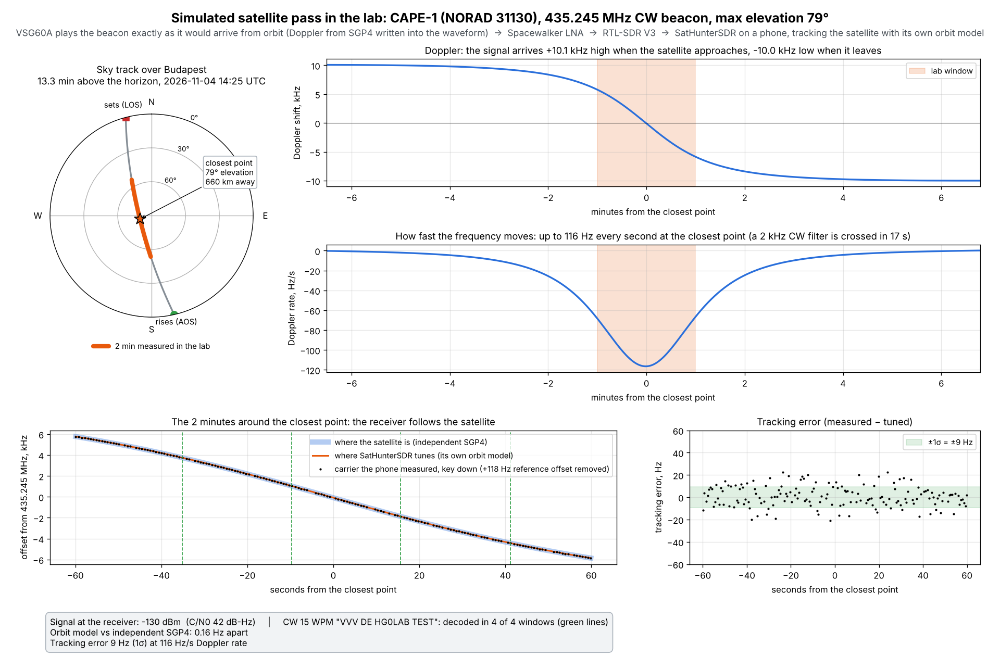

### Receive chain: noise figure, sensitivity, CW decode

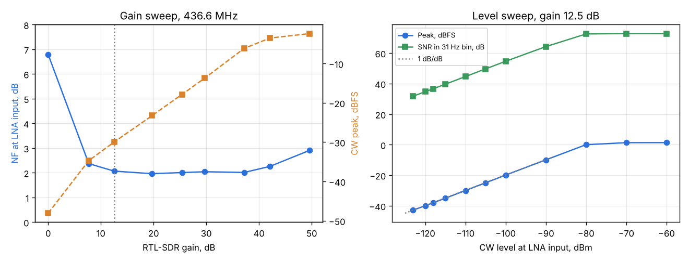

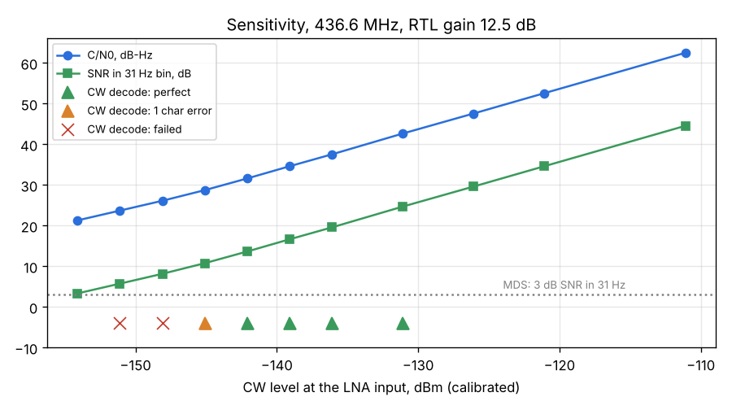

The keyed CW test signal on the VSG60A (driven over SCPI by `tools/lab/lab.py`):

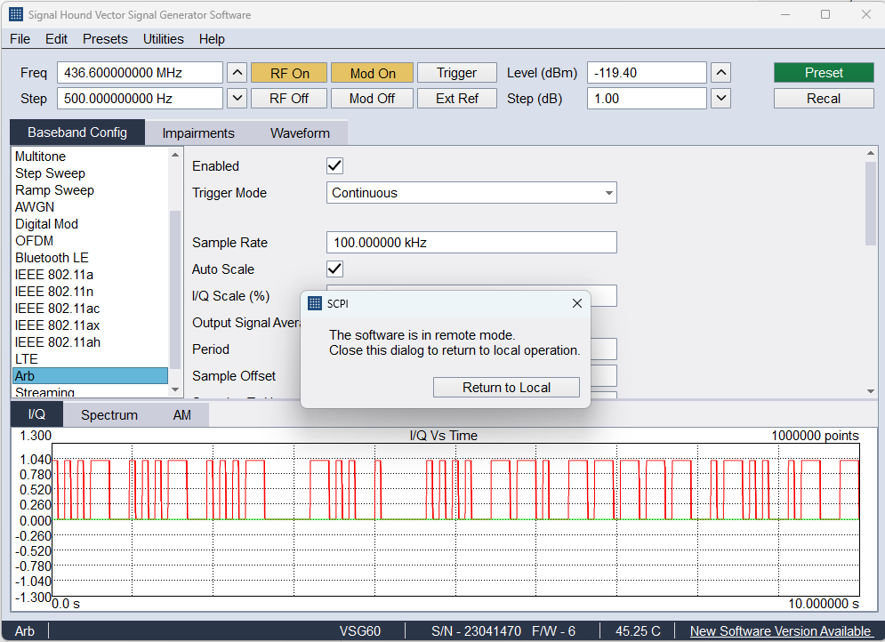

### What the measurements fixed

The frequency error depended on the sample rate (the R820T2's fractional-N PLL residual was not applied) and
the APRS decoder was limited by its FM-discriminator detector; both were fixed and measured again
(all fixes: [summary PDF](docs/report/SatHunterSDR-lab-field-summary.pdf), page 2).

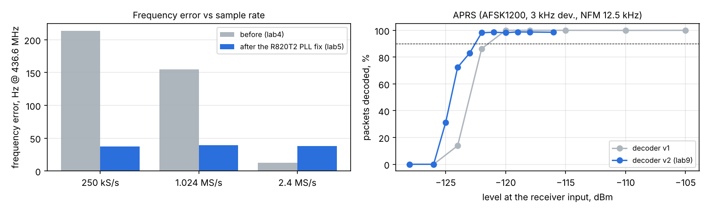

APRS packet success vs level, decoder v2 ([report](measurements/2026-11-03_1554_aprs-lab9-3k/report.md)):

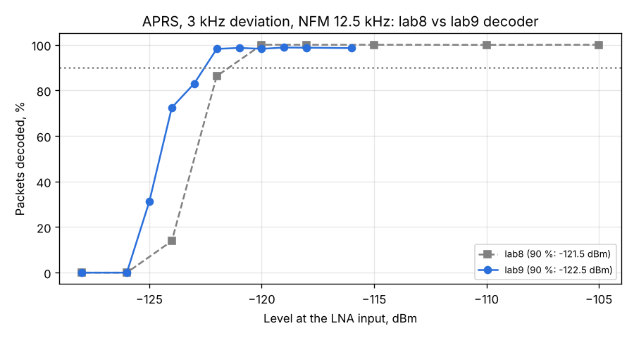

SSTV Robot 36 at the sensitivity limit, with line-sync re-acquisition ([report](measurements/2026-11-06_0941_sstv-robot36-lab15/report.md)):

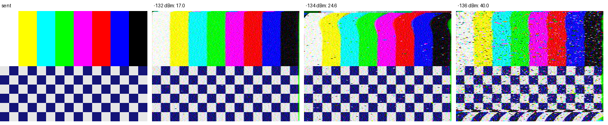

### Spacewalker LNA 434 MHz

The LNA on its own with a VSG60A and a BB60C: transfer function from a 90-tone comb (200 kHz steps), compression,
two-tone, blocking, harmonics, spurs, noise figure, supply sweep and reverse isolation
([full characterisation](docs/LNA-CHARACTERISATION.md)).

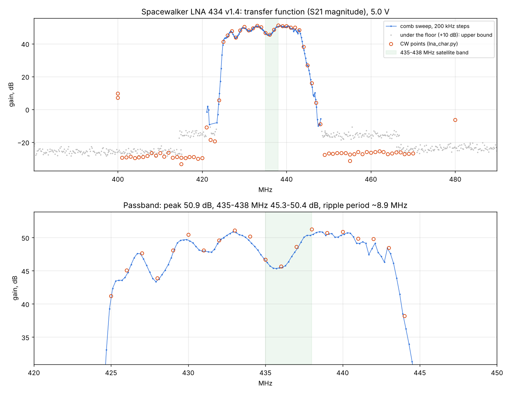

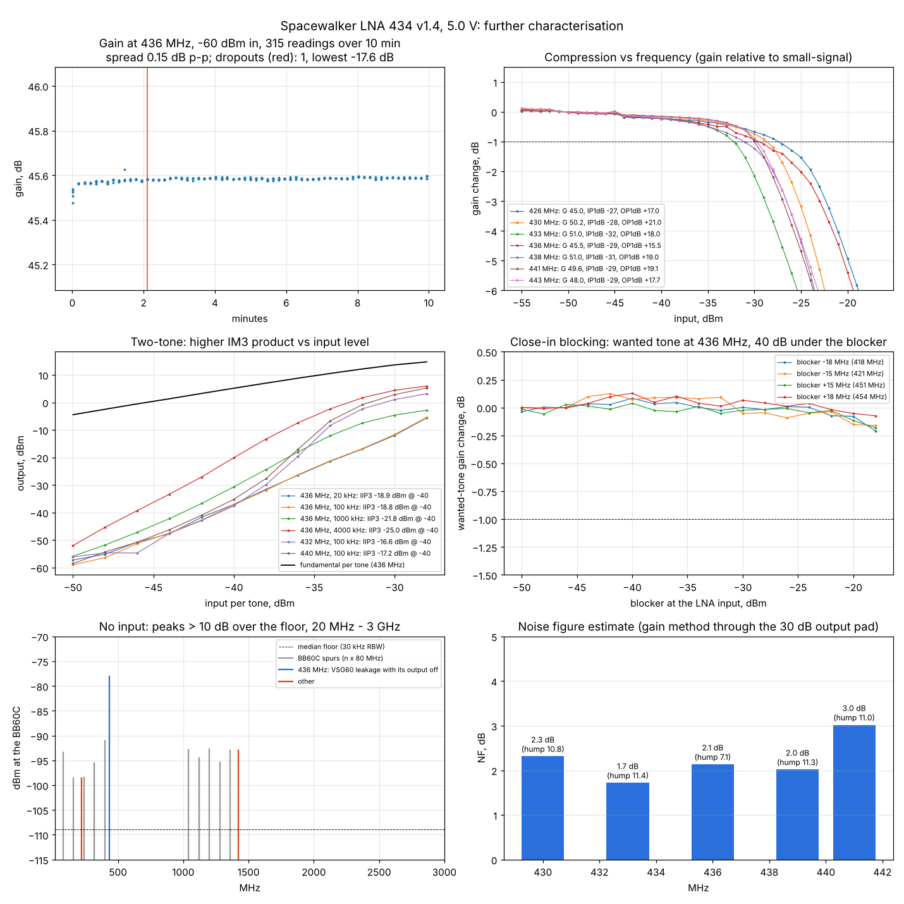

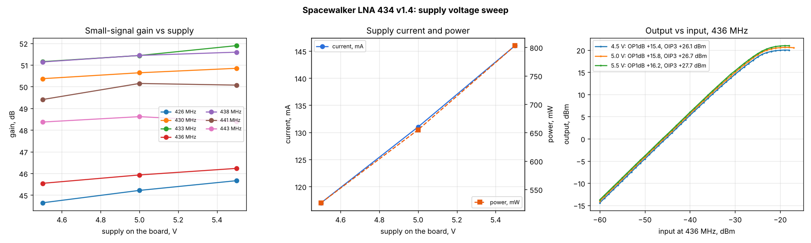

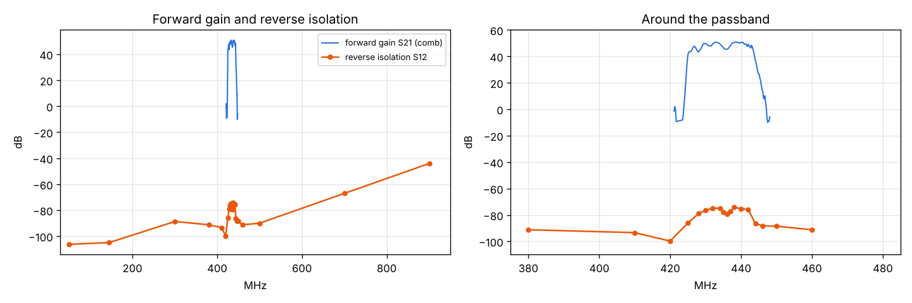

## Layout

```
core/       Rust: sh-sat, sh-dsp, sh-sources, sh-plugin, sh-engine, sh-android (JNI)
android/    Kotlin + Jetpack Compose app
catalog/    satellite profiles (index.json)
plugins/    decoder plugins (Luau), one folder each
docs/       ARCHITECTURE.md, LAB.md, LNA-CHARACTERISATION.md, MEASUREMENTS.md (field), PLUGINS.md, report/ (summary PDF)
measurements/  lab runs: report.md, plots and raw data per run (index: measurements/README.md)
tools/lab/  lab scripts (phone lab link, VSG60A, BB60C)
```

## Build

```
cd core && cargo test --release --workspace
cargo install cargo-ndk
cd core && cargo ndk -t arm64-v8a -t armeabi-v7a -t x86_64 -P 26 -o ../android/app/src/main/jniLibs build --release -p sh-android
cd android && ./gradlew assembleRelease
```

CI builds the APK on every push; it is under Actions → Build → artifacts. Tags `v*` make a release.

## License

GPL-3.0-or-later. Satellite data: SatNOGS DB (CC BY-SA 4.0), CelesTrak.
SGP4 by the `sgp4` crate (MIT), FFT by `rustfft` (MIT / Apache-2.0).
