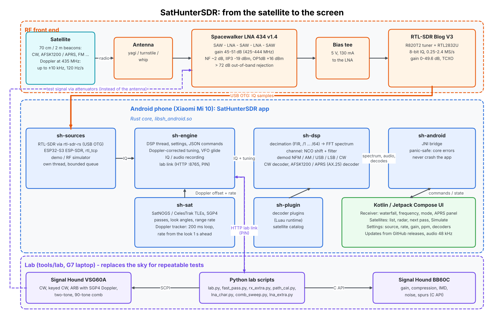
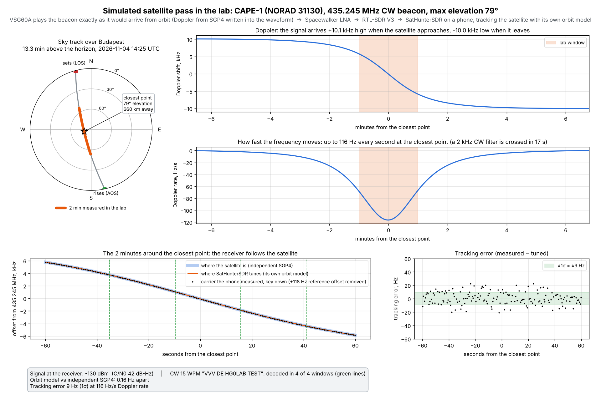

# SatHunterSDR architecture

(Source: `tools/lab/plot_block_diagram.py`; SVG: [img/sathunter-block-diagram.svg](img/sathunter-block-diagram.svg).)

## Signal path

| Block | What it does | Key figures |
|---|---|---|
| Satellite | 70 cm / 2 m amateur and CubeSat beacons: CW, AFSK1200 / APRS, FM | Doppler at 435 MHz up to ±10 kHz, up to ~120 Hz/s at the closest point of a high LEO pass |
| Antenna | yagi, turnstile or whip | - |
| [Spacewalker LNA 434 v1.4](LNA-CHARACTERISATION.md) | SAW - LNA - SAW - LNA - SAW, powered over the coax | 45-51 dB gain in 425-444 MHz, NF ~2 dB, IIP3 about -19 dBm, OP1dB +16 dBm, > 72 dB out-of-band rejection |
| Bias tee | 5 V to the LNA through the coax | 130 mA at 5.0 V on the board |
| RTL-SDR Blog V3 | R820T2 tuner + RTL2832U, 8-bit IQ | 0.25-2.4 MS/s, gain 0-49.6 dB, TCXO (+0.09 ppm after warm-up, measured) |
| USB OTG | IQ samples into the phone | - |

## Software (one Rust core, thin Android UI)

| Crate / part | Role |
|---|---|
| `sh-sources` | Signal sources: RTL-SDR through `rtl-sdr-rs` (vendored in `core/third_party`, with a fix that applies the R820T2's fractional-PLL error in Hz), ESP32-S3 ESP-SDR, rtl_tcp, a demo / RF simulator source. Each runs its own thread and pushes blocks into a bounded queue; a full queue drops a block (counted) rather than stalling USB. |
| `sh-engine` | Owns the source, the DSP thread, the satellite tracker and the settings. The UI talks to it with JSON commands. Doppler-corrected tuning: the tracker's offset plus a **VFO glide** (rate from the look one second ahead) so the channel moves smoothly between the 200 ms updates. IQ / audio recording. The **lab link** (HTTP on port 8765, PIN) for measurements, see [LAB.md](LAB.md). |
| `sh-dsp` | Decimation (FIR, /1 ... /64), FFT spectrum, channel extraction (NCO shift + filter), demodulators (NFM, WFM, AM, USB, LSB, CW), CW decoder, AFSK1200 / AX.25 / APRS decoder (650 Hz low-pass, DPLL, NRZI / HDLC, CRC-16, soft repair of the 24 least confident bits). Allocation-free in the steady state. |
| `sh-sat` | SatNOGS DB and CelesTrak data, SGP4 orbits, pass prediction, look angles and range rate, the Doppler tracker, Maidenhead locators. No I/O. |
| `sh-plugin` | Decoder plugins (Luau runtime, being wired in) and the satellite catalog. |
| `sh-android` | JNI bridge for `io.z2labs.sathunter.Native`; every entry point catches panics. |
| Android UI | Kotlin + Jetpack Compose: receiver (waterfall, frequency, mode, APRS panel), satellites (list, radar, next pass, **Simulate**: jump the clock to a pass), settings (source, rate, gain, ppm, decoders, updates from GitHub releases), 48 kHz audio. |

## Doppler tracking, and how it is tested

The tracker computes the satellite's range rate from SGP4 every 200 ms and tunes the receiver to
`f_tx x (1 - range_rate / c)`; between updates the VFO glides at the predicted rate, so even at
116 Hz/s the channel never jumps. In the lab the sky is replaced by a Signal Hound VSG60A: the pass
is computed with an independent SGP4 (python `sgp4`), written into one ARB waveform with the Doppler
in it, and started when the phone's simulated clock reaches the right moment
([fast pass report](../measurements/2026-11-04_1447_fast-pass/report.md)).

(Source: `tools/lab/plot_pass_explainer.py measurements/2026-11-04_1447_fast-pass docs/img/pass-simulation.png`.)

Results of that run: the phone's orbit model and the independent SGP4 agree to 0.16 Hz; the measured
carrier stays within ±9 Hz (1σ) of where the phone tunes, through the closest point at 116 Hz/s; CW at
-130 dBm (C/N0 42 dB-Hz) was decoded in all four windows.

## Lab instruments

| Instrument | Use | Driven by |
|---|---|---|
| Signal Hound VSG60A | CW, keyed CW, APRS, ARB with SGP4 Doppler, two-tone, 90-tone comb | SCPI through the VSG software (`tools/lab/lab.py`, class `Vsg60Gen`) |
| Signal Hound BB60C | gain, compression, IMD, noise density, spurs | its C API (`tools/lab/bb60.py`, ctypes) |
| The phone itself | level, SNR, C/N0, CW / APRS decodes, IQ and audio | the lab link (`tools/lab/lab.py`, class `Phone`) |

The scripts and the instruments' quirks are described in [LAB.md](LAB.md); every run's report is
indexed in [measurements/README.md](../measurements/README.md).
