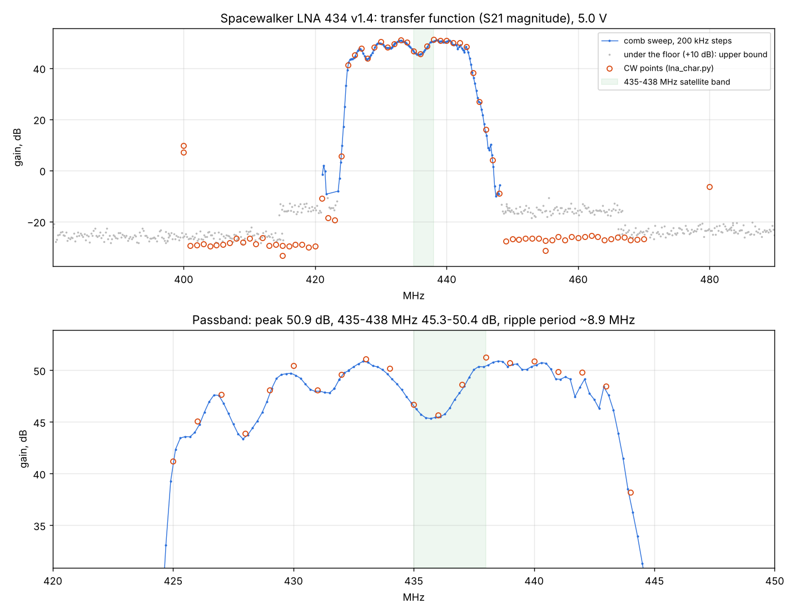

# Spacewalker LNA 434 MHz v1.4 (Decent Labs): lab characterisation

Measured 2026-11-04/05 with a Signal Hound VSG60A and BB60C, the LNA on its own, powered through a bias tee.
Every number links to a run folder in [measurements/](../measurements/README.md) with its report, plots and raw data;
the scripts are in [tools/lab](../tools/lab) (see [LAB.md](LAB.md#rf-instruments-vsg60a--bb60c-component-tests)).



## Summary

| Parameter | Result | Run |
|---|---|---|
| Topology | SAW - LNA - SAW - LNA - SAW, DC over the output coax | - |
| Gain, 435-438 MHz | 45.3-50.4 dB (dip at 436 MHz) | [comb](../measurements/2026-11-04_1546_lna-comb/results.json) |
| Gain, peak | 50.9 dB at 438.5 MHz | comb |
| Passband ripple, 430-440 MHz | 5.5 dB peak to peak, period ~9 MHz (SAW cascade, by design) | comb |
| Passband, -3 / -10 / -40 dB | 429.1-442.9 / 425.1-443.7 / 424.3-446.1 MHz (outermost points) | comb |
| Skirts | about 20 dB/MHz | comb |
| Out-of-band rejection (vs the passband) | 72 dB at 50 and 350 MHz, 74-81 dB at 380, 500-700 MHz, > 80 dB at 100, 145, 200, 900, 1000 MHz | [CW](../measurements/2026-11-04_1530_spacewalker-lna/report.md) |
| Noise figure | **2-4 dB**: 2.6-4.1 dB by the BB60C gain method, 2.0 dB from the full-chain measurement; Y-factor pending | [NF](../measurements/2026-11-05_lna-nf/report.md) |
| Input / output P1dB | -27 ... -32 dBm / +15.5 ... +21 dBm (426-443 MHz) | [extra](../measurements/2026-11-04_1556_lna-extra/report.md) |
| Maximum output | +20 ... +21 dBm | [supply](../measurements/2026-11-05_lna-supply-sweep/report.md) |
| IIP3 / OIP3, 436 MHz, 100 kHz spacing | about -18 / +27 dBm (read at -36 ... -32 dBm per tone) | extra, [thru](../measurements/2026-11-05_0856_thru-check/report.md) |
| IIP3 vs spacing (436 MHz, -40 dBm/tone) | 20 kHz -18.9, 100 kHz -18.8, 1 MHz -21.8, 4 MHz -25.0 dBm | extra |
| Close-in blocking (418 / 421 / 451 / 454 MHz) | < 0.25 dB desense up to a -18 dBm blocker | extra |
| Harmonics (2f, 3f) | < -64 dBc (analyser-limited) | extra |
| Reverse isolation S12 | -74 ... -79 dB in the passband, -84 ... -106 dB out of band, -44 dB at 900 MHz | [S12](../measurements/2026-11-05_1053_lna-reverse-s12/report.md) |
| Stability | no oscillation 20 MHz - 3 GHz with no input; gain 0.15 dB peak to peak over 10 min, ±0.01 dB over 5 min | extra, NF |
| Supply (on the board) | 4.5 V 117 mA / 5.0 V 131 mA / 5.5 V 146 mA; gain +0.7 dB, OP1dB +0.8 dB from 4.5 to 5.5 V | supply |

Absolute levels (P1dB, IP3) are referred to the LNA's input with the measured input path (23.7 dB at 436 MHz);
the first runs assumed 24.3 dB, so their input-referred levels are about 0.6 dB low and output-referred
levels 0.6 dB high. Gain is not affected (the whole path was calibrated without the LNA).

## Setup

```
VSG60A ── 20 dB ── long coax ── LNA ── bias tee ── 30 dB ── BB60C
                                          │ DC: lab supply, 5.22 V for 5.0 V on the board (1.7 Ω in the feed)
```

1. [path-cal](../measurements/2026-11-04_1523_path-cal/results.json): the whole path without the LNA, 50 MHz - 1 GHz (54.8 dB at 434 MHz).
2. [input-path-cal](../measurements/2026-11-05_1031_input-path-cal/results.json): VSG60A - 20 dB - coax only (23.7 dB at 436 MHz).
3. LNA runs: gain (CW and 90-tone comb), compression, two-tone, blocking, harmonics, spur scan, supply sweep
   with the 30 dB output pad; noise figure without it.

## Findings worth knowing

- **Ripple**: the cascade of three SAW filters gives a 5.5 dB ripple in 430-440 MHz with a dip at 436 MHz,
  right in the satellite band; it also lowers OP1dB there (+15.5 dBm vs +17...+21 dBm elsewhere). The NF
  varies by about 1.5 dB across the band as well.
- **Selectivity** is excellent: blockers 15-18 MHz away at -18 dBm do nothing; 2 m, GSM 900 and broadcast
  are 72-80+ dB down.
- **Linearity** is far beyond what an RTL-SDR behind it can use: the RTL's ADC clips at about -85 dBm at the
  LNA input (gain 12.5 dB), 56 dB under the LNA's IP1dB.
- **Supply**: works fully from 4.5 V; with a long bias-tee feed the drop (0.22 V at 131 mA here) matters little.
- **Dropouts (open)**: rarely (1 in 315 readings at -60 dBm in; more often near full drive) the output drops
  by 60+ dB for a moment. The instruments alone never did it (0 in 5027 readings); the LNA, its supply or the
  bias-tee DC path is the suspect.

## Still to do

- Y-factor NF with a calibrated noise source.
- S11 / S22 (VNA or a directional coupler) for a full stability factor.
- Find the dropouts.
- Temperature: gain and NF over -20 ... +50 °C.
