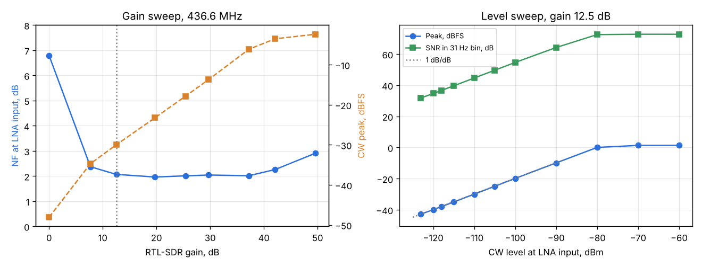
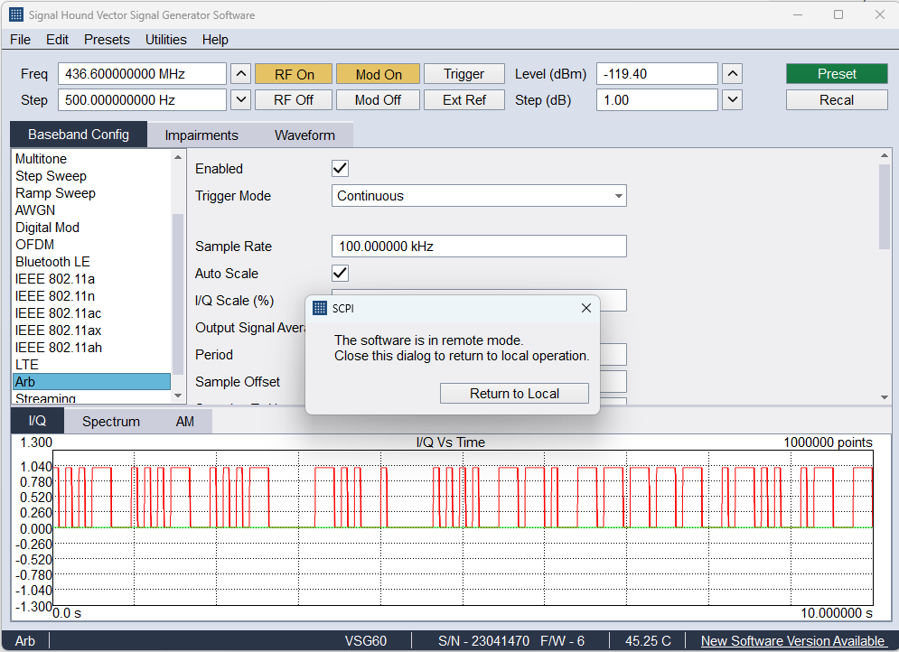

# System A: VSG60 -> Spacewalker LNA -> RTL-SDR -> SatHunterSDR (Mi 10), 436.6 MHz

Run: 2026-11-02 10:28-10:36, automated with `tools/lab/lab.py` (VSG60A over SCPI, phone over the lab link).

## Setup

| Item | Value |
|---|---|
| Generator | Signal Hound VSG60A (S/N 23041470), ARB mode, 100 kS/s waveforms, Auto Scale ON |
| Cable | 1.5 m coax, 3.6 dB loss at 434 MHz (measured against a BB60C); no attenuator |
| LNA | Spacewalker LNA 434 MHz v1.4 (Decent Labs), powered by the RTL-SDR bias tee; DC-blocked input |
| Receiver | RTL-SDR Blog V3 (R820T), 1.024 MS/s |
| Phone / app | Xiaomi Mi 10, USB OTG, SatHunterSDR v0.2.0-beta10-lab2 (debug mode, lab link) |
| Reference plane | All levels are at the LNA input (generator level minus 3.6 dB) |

## Results

| Quantity | Result |
|---|---|
| System noise figure (AWGN noise rise, gain 12.5-37 dB) | **2.0 dB** (1.96-2.07 dB) |
| System noise figure (from CW C/N0 at -110 dBm) | 1.4 dB (N0 = -110 - 62.6 = -172.6 dBm/Hz) |
| Best RTL gain | 12.5 dB: NF within 0.1 dB of the best, most headroom |
| Linearity at gain 12.5 dB | 1.00 dB/dB from -123 to -90 dBm |
| ADC full scale at gain 12.5 dB | about -85 dBm CW at the LNA input |
| Frequency error | +149 Hz = **+0.34 ppm** at 436.6 MHz (ppm correction 0) |
| CW at -123 dBm | C/N0 49.8 dB-Hz, SNR 31.8 dB in a 31 Hz bin; decoded perfectly |
| CW decode, 15 WPM | 100 % at -105, -115, -120 and -123 dBm (lowest level the VSG60 reaches) |
| Extrapolated MDS (3 dB SNR, 31 Hz bin) | about -152 dBm |

### Notes

- The two noise figure methods differ by 0.6 dB. The AWGN figure relies on the VSG60 absolute level at -110 dBm
  and on Auto Scale mapping the waveform peak to the set level (9.94 dB peak-to-average corrected); the CW
  figure relies on the absolute level and the window noise bandwidth. Both are inside the VSG60 level accuracy.
  A BB60C check of the AWGN level will settle it. The NF includes the LNA's SAW filter and the LNA input match.
- Below 7.7 dB RTL gain the R820T noise starts to count (6.8 dB NF at 0 dB). Above 42 dB the ADC runs close to
  full scale with the LNA's gain and the NF rises.
- The sensitivity floor was not reached: the VSG60 stops at -120 dBm (-123.6 dBm at the LNA input). The next
  run needs a 30-40 dB external attenuator to find the MDS and the CW decode threshold.
- With the generator off a spur sits 18.6 kHz below 436.6 MHz (about 14 dB over the per-bin floor). It is
  small against the AWGN and does not change the NF; its source is still to be found.

## Raw output of lab.py

### Lab measurement 2026-11-02 10:28:55

Generator: vsg60, 436.600000 MHz, attenuation 3.6 dB. Chain: VSG60A -> 1.5 m cable (3.6 dB at 434 MHz, measured vs BB60C) -> Spacewalker LNA 434 MHz v1.4 (bias tee powered) -> RTL-SDR Blog V3 (R820T) -> Xiaomi Mi 10 (USB OTG). Levels are at the LNA input.

Phone: {'source': 'rtl', 'source_status': 'tuner r820t, 1.024 MS/s, gain 12.4 dB, bias tee ON', 'rate': 1024000.0, 'gain': 12.391913414001465, 'ppm': 0.0, 'bias_tee': True, 'decimation': 2, 'bins': 4096}

Noise floor: -74.6 dBFS per 31 Hz bin

Frequency: offset +149.4 Hz (+0.34 ppm) at 44.6 dB SNR

## Gain sweep and system noise figure

AWGN 80 kHz wide at -165, -158 dBm/Hz at the receiver input (file peak-to-average 9.94 dB), measured in the middle 60 kHz. NF = PSD + 174 - rise, rise = AWGN / receiver noise in the channel. CW at -110 dBm for C/N0.

| Gain dB | NF dB | NF spread dB | Noise off dBFS/bin | CW C/N0 dB-Hz | CW peak dBFS |
|---|---|---|---|---|---|
| 0.0 | 6.79 | 0.51 | -81.0 | 57.3 | -48.1 |
| 7.7 | 2.37 | 0.09 | -72.5 | 61.8 | -34.7 |
| 12.5 | 2.07 | 0.05 | -68.0 | 62.0 | -30.0 |
| 19.7 | 1.96 | 0.33 | -61.4 | 62.1 | -23.3 |
| 25.4 | 2.01 | 0.17 | -56.0 | 62.2 | -17.8 |
| 29.7 | 2.04 | 0.15 | -51.9 | 62.2 | -13.7 |
| 37.2 | 2.01 | 0.13 | -44.2 | 62.3 | -6.1 |
| 42.1 | 2.26 | 0.52 | -40.9 | 62.6 | -3.5 |
| 49.6 | 2.91 | 0.86 | -38.7 | 62.4 | -2.4 |

Chosen gain for the level sweep: 12.5 dB (lowest gain within 0.3 dB of the best NF).

## Level sweep

| Level dBm | Passes | Peak dBFS | SNR dB | SNR spread dB | C/N0 dB-Hz | Offset Hz |
|---|---|---|---|---|---|---|
| -60.0 | 2 | 1.4 | 72.7 | 0.2 | 90.7 | +148.1 |
| -70.0 | 2 | 1.4 | 72.7 | 0.0 | 90.7 | +148.0 |
| -80.0 | 2 | 0.0 | 72.5 | 0.0 | 90.5 | +148.3 |
| -90.0 | 2 | -9.9 | 64.2 | 0.0 | 82.2 | +148.0 |
| -100.0 | 2 | -19.9 | 54.6 | 0.1 | 72.6 | +148.2 |
| -105.0 | 2 | -24.9 | 49.6 | 0.0 | 67.6 | +147.8 |
| -110.0 | 2 | -30.0 | 44.6 | 0.0 | 62.6 | +148.2 |
| -115.0 | 2 | -35.0 | 39.6 | 0.0 | 57.6 | +148.8 |
| -118.0 | 2 | -38.0 | 36.6 | 0.0 | 54.6 | +147.8 |
| -120.0 | 2 | -39.9 | 34.7 | 0.0 | 52.7 | +147.8 |
| -123.0 | 2 | -42.8 | 31.8 | 0.0 | 49.8 | +148.0 |

Sensitivity (SNR 3 dB in a 31 Hz bin): not reached in the sweep

Levels are at the receiver input (generator level minus --atten); the VSG60's absolute level is ±2 dB.

| CW level dBm | Decoded | OK | WPM |
|---|---|---|---|
| -105.0 | `AVV DE HG0LAB TEST VVV DE HG0LAB TEST VVV` | yes | 16.3 |
| -115.0 | `AVV DE HG0LAB TEST VVV DE HG0LAB TEST VVH` | yes | 16.0 |
| -120.0 | `TVV DE HG0LAB TEST VVV DE HG0LAB TEST VVV` | yes | 16.2 |
| -123.0 | `AVV DE HG0LAB TEST VVV DE HG0LAB TEST VVV` | yes | 15.9 |
