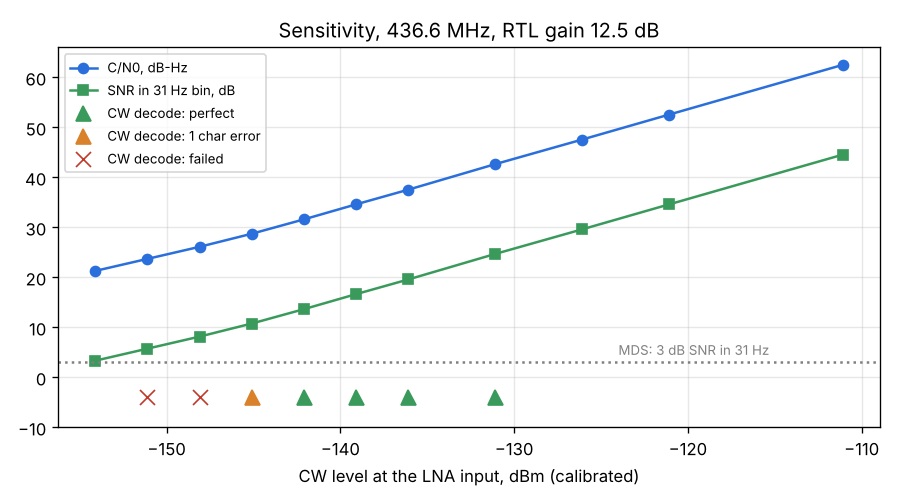

# System A2: sensitivity and CW decode threshold, 436.6 MHz

Run: 2026-11-02 10:44-10:58, `tools/lab/lab.py`. Same chain as [System A](../2026-11-02_1028_system-a/report.md)
with a 30 dB attenuator after the VSG60, so the generator reaches -154 dBm at the LNA input.

## Setup

| Item | Value |
|---|---|
| Chain | VSG60A -> 30 dB attenuator -> 1.5 m cable (3.6 dB) -> Spacewalker LNA 434 MHz v1.4 (bias tee) -> RTL-SDR Blog V3 -> Xiaomi Mi 10 |
| RTL gain | 12.5 dB fixed (the best gain from System A) |
| Spectrum | 1.024 MS/s, decimation 8 (128 kHz span), 4096 bins = 31.25 Hz |
| CW | 15 WPM, "VVV DE HG0LAB TEST", 2 copies per decode |

**Level calibration.** The raw table below uses the nominal 33.6 dB. At -110 dBm the CW peak was -31.1 dBFS here
and -30.0 dBFS in System A (same gain, no attenuator), so the attenuator path is 1.1 dB more than nominal.
The results use calibrated levels (nominal - 1.1 dB).

## Results (calibrated levels at the LNA input)

| Quantity | Result |
|---|---|
| MDS (3 dB SNR in a 31 Hz bin) | **-154.4 dBm** |
| Implied noise density | -172.6 dBm/Hz (C/N0 tracks the level 1:1 from -111 to -151 dBm) |
| CW decode, 15 WPM, perfect | down to **-142.1 dBm** (C/N0 31.5 dB-Hz) |
| CW decode, 1 character error in 2 copies | -145.1 dBm (C/N0 29.0 dB-Hz) |
| CW decode fails | -148.1 dBm (C/N0 26.6 dB-Hz) and below |
| System NF check (AWGN noise rise) | 2.2 dB with nominal levels, 1.1 dB with the calibration above |
| Frequency error | +151 Hz, +0.35 ppm (same as System A) |

### Notes

- The CW decoder works to about 29 dB-Hz. A human operator copies 15 WPM CW at about 20-23 dB-Hz,
  so there is 6-9 dB to gain in the decoder (narrower matched filter, better envelope threshold).
- For a satellite beacon: -145 dBm at the LNA input is the decode limit with this chain.
- The 1.1 dB calibration and the earlier 2.0 vs 1.4 dB NF difference both point to the VSG60's absolute
  level. A BB60C check of the generator levels will fix the last dB.

## Raw output of lab.py (nominal levels)

### Lab measurement 2026-11-02 10:44:28

Generator: vsg60, 436.600000 MHz, attenuation 33.6 dB. Chain: VSG60A, 30 dB attenuator, 1.5 m cable (3.6 dB), Spacewalker LNA 434 MHz v1.4 (bias tee), RTL-SDR Blog V3, Xiaomi Mi 10. Levels at the LNA input (attenuator nominal 30 dB).

Phone: {'source': 'rtl', 'source_status': 'tuner r820t, 1.024 MS/s, gain 12.5 dB, bias tee ON', 'rate': 1024000.0, 'gain': 12.5, 'ppm': 0.0, 'bias_tee': True, 'decimation': 8, 'bins': 4096}

Noise floor: -75.7 dBFS per 31 Hz bin

Frequency: offset +150.8 Hz (+0.35 ppm) at 44.5 dB SNR

## Gain sweep and system noise figure

AWGN 80 kHz wide at -165, -158 dBm/Hz at the receiver input (file peak-to-average 9.94 dB), measured in the middle 60 kHz. NF = PSD + 174 - rise, rise = AWGN / receiver noise in the channel. CW at -110 dBm for C/N0.

| Gain dB | NF dB | NF spread dB | Noise off dBFS/bin | CW C/N0 dB-Hz | CW peak dBFS |
|---|---|---|---|---|---|
| 12.5 | 2.21 | 0.15 | -69.0 | 62.0 | -31.0 |

Chosen gain for the level sweep: 12.5 dB (lowest gain within 0.3 dB of the best NF).

## Level sweep

| Level dBm | Passes | Peak dBFS | SNR dB | SNR spread dB | C/N0 dB-Hz | Offset Hz |
|---|---|---|---|---|---|---|
| -110.0 | 2 | -31.1 | 44.5 | 0.0 | 62.5 | +149.9 |
| -120.0 | 2 | -41.1 | 34.6 | 0.0 | 52.5 | +149.2 |
| -125.0 | 2 | -46.1 | 29.6 | 0.0 | 47.5 | +149.3 |
| -130.0 | 2 | -51.0 | 24.7 | 0.0 | 42.6 | +149.1 |
| -135.0 | 2 | -56.1 | 19.6 | 0.1 | 37.5 | +150.4 |
| -138.0 | 2 | -59.0 | 16.6 | 0.3 | 34.6 | +149.6 |
| -141.0 | 2 | -62.1 | 13.6 | 0.2 | 31.6 | +148.5 |
| -144.0 | 2 | -64.9 | 10.8 | 0.1 | 28.7 | +150.1 |
| -147.0 | 2 | -67.5 | 8.2 | 0.1 | 26.1 | +147.5 |
| -150.0 | 2 | -69.9 | 5.7 | 0.4 | 23.7 | +148.6 |
| -153.0 | 2 | -72.4 | 3.3 | 1.4 | 21.3 | +148.6 |

Sensitivity (SNR 3 dB in a 31 Hz bin): not reached in the sweep

Levels are at the receiver input (generator level minus --atten); the VSG60's absolute level is ±2 dB.

| CW level dBm | Decoded | OK | WPM |
|---|---|---|---|
| -130.0 | `AVV DE HG0LAB TEST VVV DE HG0LAB TEST VVV` | yes | 15.4 |
| -135.0 | `EVV DE HG0LAB TEST VVV DE HG0LAB TEST VVV` | yes | 15.1 |
| -138.0 | `AVV DE HG0LAB TEST VVV DE HG0LAB TEST VVV` | yes | 15.3 |
| -141.0 | `TVV DE HG0LAB TEST VVV DE HG0LAB TEST VVV` | yes | 15.2 |
| -144.0 | `TVV DE HG0LAB TEST VVV DE HG~LAB TEST V4V` | no | 15.1 |
| -147.0 | `A4~ 6 HM ~LABEAEHNE EII5V DE HZ~LA~ REST V~IA` | no | 16.4 |
| -150.0 | `` | no | 0.0 |
