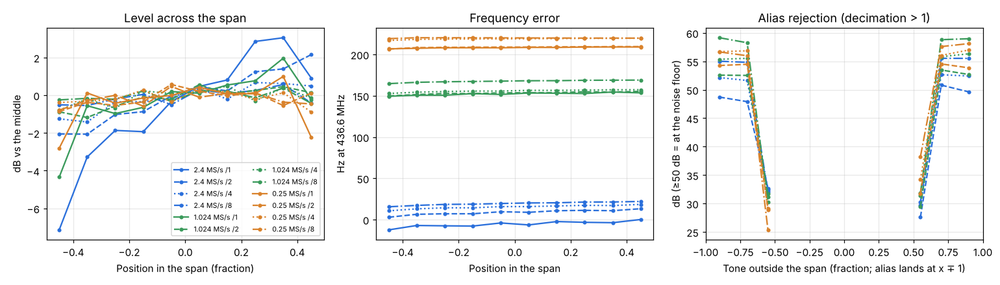

# DSP check A: sample rates and decimation

Run: 2026-11-02 11:24-11:34, `tools/lab/dsp_check.py --part decim` (VSG60A over SCPI, phone over the lab link,
SatHunterSDR v0.2.0-beta10-lab3). Chain as in [System A2](../2026-11-02_1044_system-a2-mds/report.md):
VSG60A, 30 dB attenuator, cable, Spacewalker LNA 434, RTL-SDR Blog V3 (gain 12.5 dB), Xiaomi Mi 10.
CW tone at -95 dBm (LNA input), 436.6 MHz area. 3 sample rates x 4 decimations = 12 configurations.

Per configuration:
- the tone at 10 positions across the span: level flatness, frequency error, level vs decimation 1
- the tone outside the span (0.55, 0.7 and 0.9 span from the centre, both sides): level of its alias
- noise floor in dBFS/Hz with the generator off
- USB demodulation of a tone 1000 Hz above the VFO: the audio pitch

## Results

| Rate | Decim. | Span | Flatness | Level vs /1 | Noise dBFS/Hz | Freq. error | Alias, folding into the centre 84 % | USB pitch |
|---|---|---|---|---|---|---|---|---|
| 2.4 MS/s | 1 | 2400 kHz | 10.2 dB (RTL roll-off at the edges) | 0 | -89.3 | -12...0 Hz | n/a | 999 Hz |
| 2.4 MS/s | 2 | 1200 kHz | 4.2 dB | -0.1 dB | -89.4 | +3...+13 Hz | > 48 dB | 1016 Hz |
| 2.4 MS/s | 4 | 600 kHz | 2.1 dB | 0.0 dB | -89.6 | +11...+18 Hz | > 52 dB | 1021 Hz |
| 2.4 MS/s | 8 | 300 kHz | 0.9 dB | 0.0 dB | -89.9 | +16...+22 Hz | > 55 dB | 1025 Hz |
| 1.024 MS/s | 1 | 1024 kHz | 6.3 dB | 0 | -89.5 | +149...+154 Hz | n/a | 1154 Hz |
| 1.024 MS/s | 2 | 512 kHz | 1.7 dB | +0.1 dB | -89.7 | +150...+155 Hz | > 53 dB | 1157 Hz |
| 1.024 MS/s | 4 | 256 kHz | 1.3 dB | +0.1 dB | -89.9 | +153...+157 Hz | > 55 dB | 1159 Hz |
| 1.024 MS/s | 8 | 128 kHz | 0.8 dB | +0.3 dB | -90.5 | +165...+169 Hz | > 58 dB | 1170 Hz |
| 0.25 MS/s | 1 | 250 kHz | 3.8 dB | 0 | -85.8 | +207...+209 Hz | n/a | 1209 Hz |
| 0.25 MS/s | 2 | 125 kHz | 1.4 dB | 0.0 dB | -86.4 | +207...+210 Hz | > 54 dB | 1210 Hz |
| 0.25 MS/s | 4 | 62.5 kHz | 1.2 dB | +0.3 dB | -86.3 | +217...+220 Hz | > 54 dB | 1220 Hz |
| 0.25 MS/s | 8 | 31.25 kHz | 1.3 dB | +0.1 dB | -86.3 | +219...+220 Hz | > 56 dB | 1219 Hz |

Alias rejection ">" means the alias was at the noise floor (alias SNR 0-6 dB), so the true rejection is higher.

## Findings

1. **Decimation works.** Level is the same at every decimation (within 0.3 dB), the noise density does not
   change, the in-band response is flat to 1-2 dB, and tones that fold into the central 84 % of the span are
   suppressed below the noise floor (> 48-58 dB). The USB pitch is right once the frequency error below is
   subtracted (1154 Hz = 1000 Hz + 154 Hz error).
2. **The outer 8 % on each side of a decimated span is not alias-free** (by design, the filter keeps the
   central 84 %): a tone 0.55 span from the centre shows up at the opposite edge only 25-34 dB down. The
   waterfall shows these edges as if they were clean. Fix: grey out or crop the outer 8 % in the display.
3. **The frequency error depends on the sample rate: +5, +155 and +210 Hz at 2.4, 1.024 and 0.25 MS/s**
   (0.01, 0.35 and 0.48 ppm), so a single ppm correction cannot be right for every rate. Cause: the
   R820T driver (`third_party/rtl-sdr-rs`, `r82xx::set_pll`, inherited from librtlsdr) truncates the PLL
   fraction to whole kHz at the VCO (up to 1 kHz / 8 = 125 Hz at the LO), and the IF, and so the LO, changes
   with the sample rate (the tuner bandwidth follows the rate). Fix: compute the SDM fraction in Hz and
   put the residual LO error into the RTL2832 IF register (6.9 Hz steps). After the fix the error should
   be the crystal's alone, the same at every rate. The decimation adds a few Hz on top (+5...+15 Hz at
   /8), within the 31-125 Hz bins.
4. **0.25 MS/s is 3.5 dB noisier** (-86 dBFS/Hz against -89.5 dBFS/Hz at the same tone level): the
   RTL2832's own decimation folds noise at its lowest rate. For narrow spans use 1.024 MS/s with /4 or
   /8 instead (same span, 3.5 dB better SNR).
5. 2.4 MS/s without decimation loses 7 dB at the lower edge of the span (RTL/R820T IF filter); /2 or more
   removes it.
