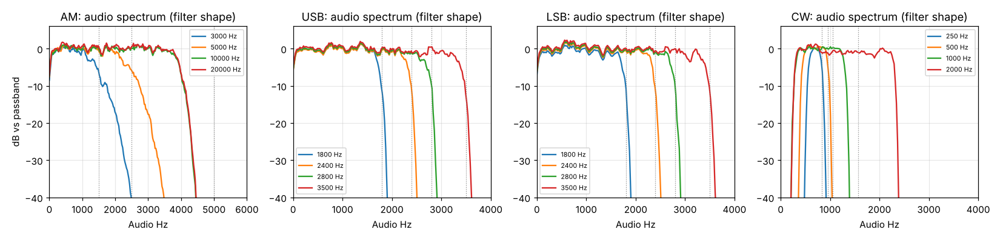

# DSP check B: demodulators and filter bandwidths

Run: 2026-11-02 11:34-11:40, `tools/lab/dsp_check.py --part bw` (SatHunterSDR v0.2.0-beta10-lab3, the
`/audio` lab endpoint). Chain as in [DSP check A](../2026-11-02_1124_dsp-check/report.md), 1.024 MS/s,
decimation 1, RTL gain 12.5 dB.

Method:
- **USB, LSB, CW:** flat noise 120 kHz wide (-145 dBm/Hz) on the VFO: the audio spectrum is the filter
  shape. The -6 dB edges are compared with the bandwidth setting.
- **AM:** a carrier (-100 dBm) amplitude-modulated 30 % by flat noise up to 15 kHz: the audio spectrum is
  the channel filter's shape (one sided, so the expected audio edge is bandwidth / 2).
- **NFM, WFM:** a 1 kHz FM tone (NFM 2.5 kHz deviation, WFM 50 kHz deviation) at -100 dBm: pitch, level
  and SINAD per bandwidth.

## Results

| Mode | Bandwidth setting | Audio passband (-6 dB) | Expected | Ratio |
|---|---|---|---|---|
| AM | 3000 Hz | 29-1488 Hz | 0-1500 Hz | 0.97 |
| AM | 5000 Hz | 12-2502 Hz | 0-2500 Hz | 1.00 |
| AM | 10000 Hz | 6-3973 Hz | 0-5000 Hz | **0.79** |
| AM | 20000 Hz | 12-3979 Hz | 0-10000 Hz | **0.40** |
| USB | 1800 / 2400 / 2800 / 3500 Hz | 0-1740 / 0-2344 / 0-2748 / 0-3416 Hz | 0-bandwidth | 0.97-0.98 |
| LSB | 1800 / 2400 / 2800 / 3500 Hz | 12-1740 / 6-2350 / 6-2730 / 0-3428 Hz | 0-bandwidth | 0.96-0.98 |
| CW | 250 Hz | 562-838 Hz | 250 Hz wide | 1.10 |
| CW | 500 / 1000 / 2000 Hz | 457-955 / 293-1301 / 287-2303 Hz | bandwidth wide | 1.00-1.01 |

| Mode | Bandwidth | Tone | Audio level | SINAD |
|---|---|---|---|---|
| NFM, 2.5 kHz dev. | 6250 Hz | 1000.0 Hz | -3.4 dBFS | 18.2 dB (Carson 7 kHz > bandwidth) |
| NFM | 12500 Hz | 1000.0 Hz | -5.3 dBFS | 34.5 dB |
| NFM | 25000 Hz | 1000.0 Hz | **-14.6 dBFS** | 34.3 dB |
| WFM, 50 kHz dev. | 50000 Hz | 1000.0 Hz | -15.5 dBFS | 3.1 dB (Carson 102 kHz > bandwidth) |
| WFM | 100000 / 180000 / 250000 Hz | 1000.0 Hz | -6.9 dBFS | 41.5 / 47.6 / 47.6 dB |

## Findings

1. **SSB, CW and narrow AM filters are right**: the -6 dB width is 96-101 % of the setting with steep skirts
   (more than 30 dB down within 150 Hz of the edge). CW 250 Hz is 10 % wide (275 Hz).
2. **AM above 8 kHz bandwidth has no effect**: the AM audio is low-passed at a fixed 4 kHz
   (`demod.rs`, `audio_cut`), so 10 and 20 kHz settings sound like 8 kHz. Fix: AM audio cut = bandwidth / 2.
3. **NFM loudness changes with the bandwidth setting: 11 dB between 6.25 and 25 kHz** for the same
   signal, and a 2.5 kHz deviation already reaches full scale at 6.25 kHz. The demodulator's reference
   deviation is derived from the bandwidth (`max(bw/2 - 3 kHz, 2.5 kHz)`). Fix: a fixed reference (5 kHz,
   with headroom), so the volume does not jump when the bandwidth changes.
4. **WFM is right** from 100 kHz up (constant level, 41-48 dB SINAD); 50 kHz is too narrow for 50 kHz
   deviation, as expected.
5. The pitch is exactly 1000.0 Hz in NFM and WFM (an FM demodulator is insensitive to the 155 Hz tuning error).

An earlier run (11:24, in the DSP check A folder) had a test-signal bug (FM deviation 2pi too high, AM with
noise only); its filter results were discarded.
