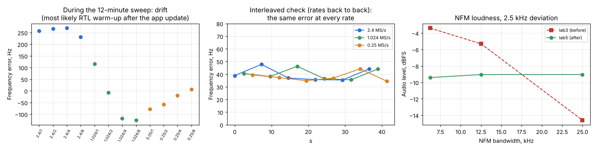

# DSP check C: after the fixes (v0.2.0-beta10-lab5)

Run: 2026-11-02 12:34-12:52, `tools/lab/dsp_check.py` (both parts) and `tools/lab/freq_interleaved.py`, on
SatHunterSDR v0.2.0-beta10-lab5, installed through the new in-app updater (triggered over the lab link).
Same chain and settings as [DSP check A](../2026-11-02_1124_dsp-check/report.md) and
[B](../2026-11-02_1134_dsp-check-bw/report.md).

Fixes in lab5:
1. R820T PLL: the sigma-delta fraction is computed in Hz (was truncated to whole kHz at the VCO) and the
   remaining LO error (half a PLL step, up to ~55 Hz at 436 MHz) is moved into the RTL2832 IF register.
2. AM audio bandwidth = filter bandwidth / 2 (was a fixed 4 kHz).
3. NFM full-scale deviation fixed at 5 kHz (was derived from the filter bandwidth).
4. Decimated spans: the outer 8 % on each side (not alias-free) is shaded in the spectrum and waterfall.

## Results

| Check | lab3 (before) | lab5 (after) |
|---|---|---|
| Frequency error, 2.4 / 1.024 / 0.25 MS/s | +5 / +155 / +210 Hz | **+40 / +40 / +38 Hz** (interleaved, 6 rounds, ±5 Hz) |
| AM 10 kHz / 20 kHz: audio -6 dB edge | 3973 / 3979 Hz | **4816 / 9650 Hz** |
| AM 3 kHz / 5 kHz | 1488 / 2502 Hz | 1412 / 2367 Hz |
| NFM audio level at 6.25 / 12.5 / 25 kHz (2.5 kHz deviation) | -3.4 / -5.3 / -14.6 dBFS | **-9.4 / -9.0 / -9.0 dBFS** |
| NFM SINAD at 12.5 / 25 kHz | 34.5 / 34.3 dB | 34.5 / 34.4 dB |
| USB, LSB, CW widths | 96-110 % of the setting | 97-108 % (unchanged) |
| WFM from 100 kHz | -6.9 dBFS, 41-48 dB SINAD | unchanged |
| Decimation: level, noise, alias rejection (centre 84 %) | ±0.3 dB, flat, > 48-58 dB | unchanged |

## Findings

1. **The frequency error no longer depends on the sample rate.** In the interleaved check all three rates
   agree within the ±5 Hz scatter: +40 Hz = +0.09 ppm, the crystal's own error, which the ppm setting can now
   correct once for every rate. The lab3 numbers fit the PLL model exactly (crystal +91 Hz at that time,
   minus the computed LO rounding error at each rate's IF: +84, -53, -102 Hz).
2. **The RTL drifted about 400 Hz (0.9 ppm) in the first ~15 minutes after the app update** (sweep, left
   plot): from +260 Hz down to -125 Hz and back up to +40 Hz, then stable. Most likely the RTL-SDR warming
   up again after the receiver was stopped. For a satellite pass: start the receiver 15 minutes early, or
   track the beacon (the CW tracker does). This also explains the few-Hz "decimation dependence" in DSP
   check A: it was drift during the sweep.
3. **AM and NFM fixed.** AM follows the setting up to 20 kHz (96 %); NFM loudness is constant (±0.4 dB)
   at every bandwidth and no longer clips.
4. The display shading of the aliased edges (fix 4) is visual; check it on the phone (decimation 2-8).
