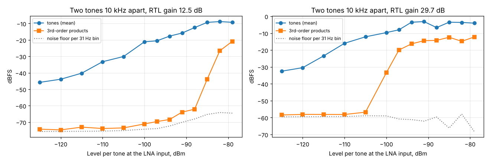

# Two-tone test: in-band intermodulation and ADC headroom

Run: 2026-11-02 13:37, `tools/lab/rx_extra.py --part twotone`, SatHunterSDR v0.2.0-beta10-lab5.
Chain as in [System A2](../2026-11-02_1044_system-a2-mds/report.md) (VSG60A, 30 dB pad, cable, Spacewalker LNA 434,
RTL-SDR V3, Mi 10), 1.024 MS/s / 8. Two equal tones 10 kHz apart inside the span (one ARB waveform); the
third-order products land 10 kHz outside each tone.

| RTL gain | Third-order products | Clipping starts (per tone, LNA input) | Spur-free range (31 Hz bin) |
|---|---|---|---|
| 12.5 dB | below -50 dBc up to -88 dBm per tone (at the noise floor up to -100 dBm) | -85 dBm (-79 dBm PEP) | about 66 dB (MDS -154 dBm to -88 dBm) |
| 29.7 dB | at the noise floor up to -105 dBm per tone | -100 dBm | about 50 dB |

## Findings

1. The chain does not produce third-order products before the 8-bit ADC clips; above that the products
   jump by 20-40 dB. The usable in-band ceiling is the ADC full scale, about -85 dBm per tone at 12.5 dB
   RTL gain, 15 dB lower at 29.7 dB. The LNA (P1dB much higher) is not the limit inside the span.
2. With strong tones the noise floor in the span rises (up to 8 dB at -88 dBm per tone, gain 12.5 dB):
   reciprocal mixing (R820T LO phase noise) or the generator's own noise. A second, clean generator
   is needed to tell them apart.
3. A single generator cannot measure blocking by far-off strong signals (out of the span) or the LNA's
   own IIP3; that is for the BB60C session.
