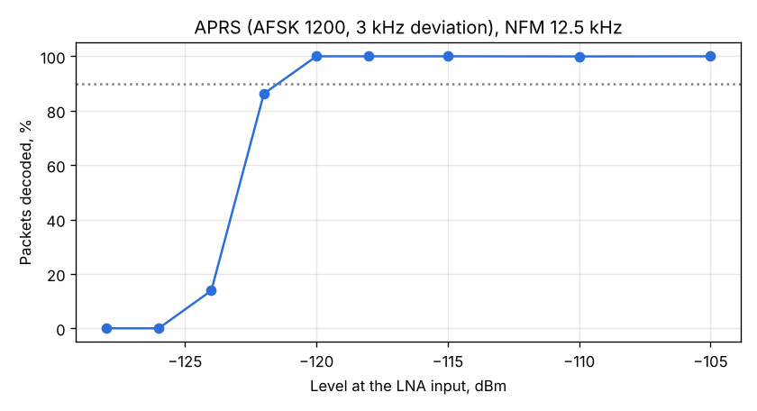

# APRS sensitivity (AFSK 1200 / AX.25)

Run: 2026-11-03 11:19-11:27, `tools/lab/rx_extra.py --part aprs`, SatHunterSDR v0.2.0-beta10-lab8 (first build
with the native APRS decoder, `sh-dsp/src/afsk.rs`). Chain as in [System A2](../2026-11-02_1044_system-a2-mds/report.md):
VSG60A, 30 dB pad, cable (34.7 dB in all), Spacewalker LNA 434, RTL-SDR V3 at 12.5 dB, Xiaomi Mi 10;
1.024 MS/s / 8, NFM 12.5 kHz, 436.6 MHz.

Signal: 10 numbered APRS UI frames (`HG0LAB-1>APRS,WIDE1-1:!4729.87N/01902.41E>SatHunter lab packet NN`,
40 flags preamble), AFSK 1200 Bd FM-modulated with 3 kHz deviation, repeated (one packet every ~1 s).
At each level the phone's decoder ran for 30 s; decoded = frames with a good CRC and the lab text.

| Level at the LNA input | Decoded | Success |
|---|---|---|
| -105 ... -120 dBm | 29-30 of ~29 | 100 % |
| -122 dBm | 25 of ~29 | 86 % |
| -124 dBm | 4 of ~29 | 14 % |
| -126, -128 dBm | 0 | 0 % |

## Findings

1. **90 % packet success at about -121.5 dBm**, with a sharp edge (100 % at -120, 14 % at -124 dBm).
2. That edge is the FM threshold of the 12.5 kHz channel: with the system noise of -172.6 dBm/Hz
   ([System A2](../2026-11-02_1044_system-a2-mds/report.md)) the carrier-to-noise in 12.5 kHz at -122 dBm is
   about 10 dB. The AFSK decoder is not the limit; a narrower channel is. For 3 kHz deviation the
   Carson bandwidth is about 10.4 kHz (~1 dB to gain); satellites with small deviation (CUBEBUG-2: about
   ±660 Hz) would gain several dB from a 5-6 kHz channel.
3. The decoder works end to end on the phone: frames with good CRC in real time, shown in the APRS panel
   and served by the lab link (`/aprs`).

Next: the same test with 1 kHz deviation and 6 / 9 / 12.5 kHz channels; a 1 dB-step sweep around the edge.
