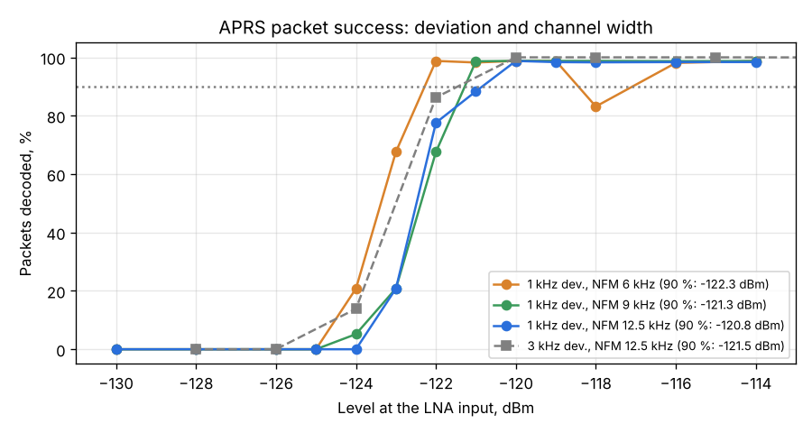

# APRS: deviation and NFM channel width

Run: 2026-11-03 11:28-11:45, `tools/lab/rx_extra.py --part aprs --aprs-dev 1000 --aprs-bws 6000,9000,12500`,
SatHunterSDR v0.2.0-beta10-lab8. Same chain and packets as the [first APRS run](../2026-11-03_1119_aprs/report.md),
now with 1 kHz FM deviation (satellites often use a small one: CUBEBUG-2 about ±660 Hz) and three NFM
channel widths; 20 s (~19 packets) per point, 1 dB steps around the edge.

| Deviation | NFM channel | 90 % packets at | 50 % at |
|---|---|---|---|
| 1 kHz | 6 kHz | **-122.3 dBm** | about -123.3 dBm |
| 1 kHz | 9 kHz | -121.3 dBm | about -122.4 dBm |
| 1 kHz | 12.5 kHz | -120.8 dBm | about -122.6 dBm |
| 3 kHz (first run) | 12.5 kHz | -121.5 dBm | about -122.8 dBm |

(One outlier: 6 kHz at -118 dBm gave 83 %, the points on both sides 98-99 %.)

## Findings

1. A narrower channel helps small-deviation signals, but only by about 1.5 dB (12.5 -> 6 kHz). The
   edge stays near -122 dBm whatever the deviation and the channel: C/N0 about 50 dB-Hz, Eb/N0 about
   19 dB at 90 % packets. That is the usual figure for AFSK through an FM discriminator; the receiver
   chain (NF 2 dB) is not the limit.
2. The way to more APRS sensitivity is the demodulator: an IQ-domain (coherent / matched-filter) AFSK
   detector instead of FM discriminator + tone detector can gain several dB. Candidate for M9.
3. Practical setting: NFM 6-9 kHz for satellites with small deviation, 12.5 kHz for the ISS digipeater
   (3 kHz deviation plus Doppler error).
