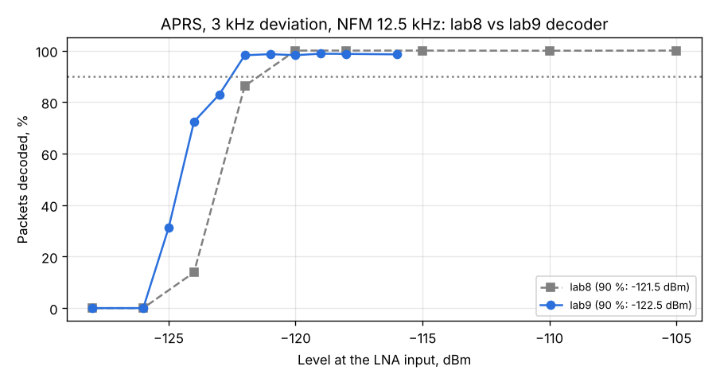

# APRS decoder v2 (lab9): narrower detector filter and soft bit repair

Run: 2026-11-03 15:54-16:00, `tools/lab/rx_extra.py --part aprs --aprs-dev 3000 --aprs-bws 12500`, SatHunterSDR
v0.2.0-beta10-lab9. Same chain and packets as the [first APRS run](../2026-11-03_1119_aprs/report.md) (lab8);
the PC driving the VSG60 was idle (26-36 % CPU) for the whole sweep.

Decoder changes (`sh-dsp/src/afsk.rs`), tuned offline with `examples/aprs_sim.rs` (FM AFSK + white noise,
which matched the lab8 measurement within 0.6 dB):
- low-pass after mixing down by 1700 Hz: 650 Hz (transition 500 Hz) instead of 1100 Hz
- bad-CRC frames are repaired by flipping one of the 24 least sure bits (or it and its neighbour, one NRZI
  line error); accepted only if the CRC matches and the addresses parse (chance of a wrong frame passing
  about 0.07 % per repaired frame; none seen in simulation or here)

| Level | lab8 | lab9 |
|---|---|---|
| -120 dBm | 100 % | 98 % |
| -122 dBm | 86 % | 98 % |
| -123 dBm | - | 83 % |
| -124 dBm | 14 % | 72 % |
| -125 dBm | - | 31 % |
| -126 dBm | 0 % | 0 % |
| **90 % point** | **-121.5 dBm** | **-122.5 dBm** |
| 50 % point | -123.0 dBm | -124.5 dBm |

## Findings

1. The new decoder gains 1.0 dB at 90 % and 1.5 dB at 50 % packet success, as the simulation predicted.
2. No wrong frames: every decoded frame carried the exact lab text.
3. The 1 kHz deviation part of this run was discarded: a compile job started on the PC half way and the
   VSG60 output got gaps (non-monotonic results, 100 % CPU). The lab tools now wait while the PC is busy
   (`wait_idle` in `tools/lab/lab.py`) and record the load per point.
