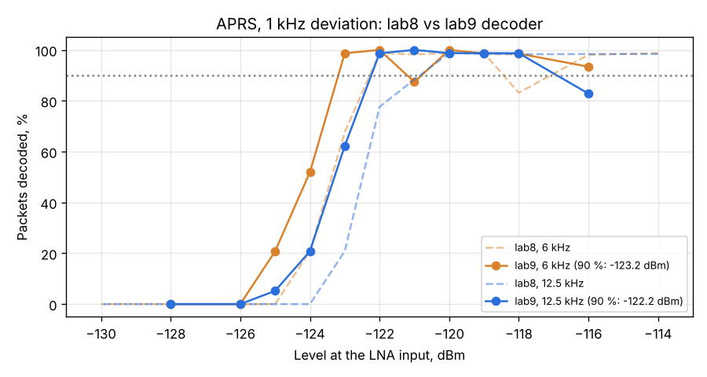

# APRS decoder v2 (lab9), 1 kHz deviation

Run: 2026-11-04 11:42-11:58, `tools/lab/rx_extra.py --part aprs --aprs-dev 1000 --aprs-bws 6000,12500`,
SatHunterSDR v0.2.0-beta10-lab9. Same as the [lab8 1 kHz run](../2026-11-03_1128_aprs-1k/report.md), now with the
v2 decoder ([3 kHz result](../2026-11-03_1554_aprs-lab9-3k/report.md)). The lab tools waited while the PC was
busy; the CPU load after each point is in `results.json` (`cpu_pct_after`).

| NFM channel | 90 % packets, lab8 | 90 % packets, lab9 | 50 %, lab8 | 50 %, lab9 |
|---|---|---|---|---|
| 6 kHz | -122.3 dBm | **-123.2 dBm** | -123.4 dBm | -124.1 dBm |
| 12.5 kHz | -120.8 dBm | **-122.2 dBm** | -122.5 dBm | -123.3 dBm |

## Findings

1. The v2 decoder gains 0.9-1.4 dB at 90 % with small deviation too; with a 6 kHz channel the 90 % point is
   -123.2 dBm, the best APRS figure so far.
2. Three points fall out of line (6 kHz: 93 % at -116 and 87 % at -121 dBm; 12.5 kHz: 83 % at -116 dBm); each
   of them had 79-88 % CPU on the PC right after the point (the load rose during the 20 s window, after the
   start check). They are left in the table and plot; the edge values above are not affected by them.
