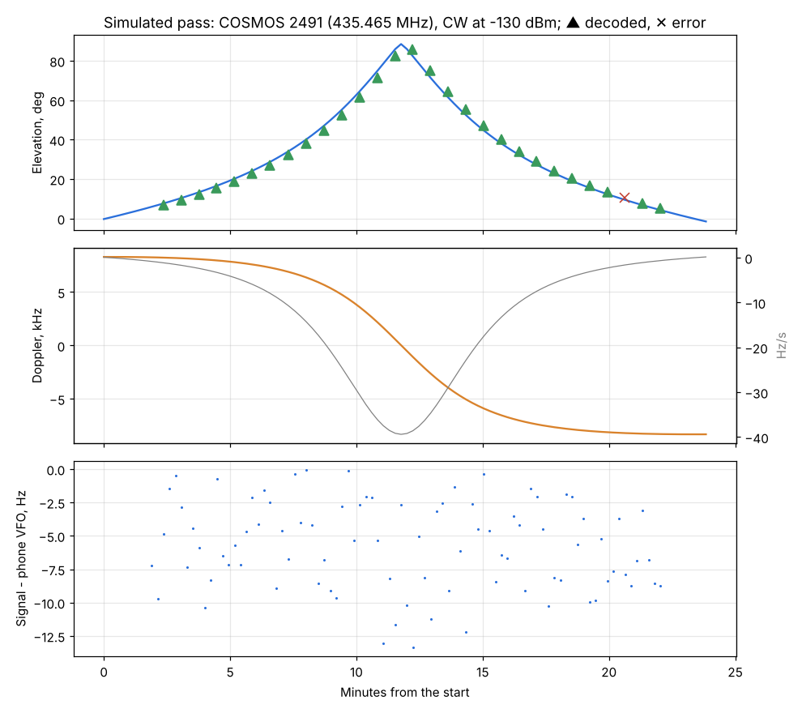

# Simulated satellite pass: COSMOS 2491, 88° elevation

Run: 2026-11-04 12:04-12:28, `tools/lab/pass_sim.py --level -130`, SatHunterSDR v0.2.0-beta10-lab9.
Chain as in [System A2](../2026-11-02_1044_system-a2-mds/report.md) (RTL gain 12.5 dB, 1.024 MS/s / 8, CW 2 kHz).

How it works: the script picks the CW satellite in 430-440 MHz with the highest next pass in the phone's
list (COSMOS 2491, 435.465 MHz, 88° maximum elevation). The phone selects it, turns on Doppler tracking and
jumps its clock to 10 s before AOS (Simulate). Four times a second the script reads the phone's look angles
and range rate and tunes the VSG60 to the frequency the satellite would be heard on
(f_tx × (1 − range rate / c)), playing keyed CW ("VVV DE HG0LAB TEST", 15 WPM) at -130 dBm above 5°
elevation. Every ~40 s the phone's CW decoder reads the last 28 s.

| Quantity | Result |
|---|---|
| Doppler | +8.3 kHz → -8.3 kHz, up to 39 Hz/s at the closest point (1500 km orbit) |
| Tracking error (VSG frequency − phone VFO) | mean -5.8 Hz, RMS 6.6 Hz, at most 13 Hz over the pass |
| CW decodes | 28 of 29 complete; the 29th lost only the first letter ("XVV DE HG0LAB TEST" twice) |
| C/N0 at the decoder | 42.1-43.0 dB-Hz all through the pass (no loss at the closest point) |

## Findings

1. The phone keeps the satellite within ±13 Hz of the VFO for the whole pass, in a 2 kHz CW filter; the
   decoder sees the same C/N0 at the horizon and overhead. Part of the error is the lab's own reading lag
   (the satellite frequency and the VFO are read 50-100 ms apart, up to 4 Hz at 39 Hz/s).
2. This checks the tracking loop, the VFO control and the decoders under real pass dynamics. It does not
   check the TLE itself (the VSG follows the phone's own orbit model); that needs an independent SGP4
   (python `sgp4`) or a real satellite.
3. A 500 km LEO has up to about 170 Hz/s at the closest point: run the same test with `--norad` on a low
   CW satellite with a high pass next.
