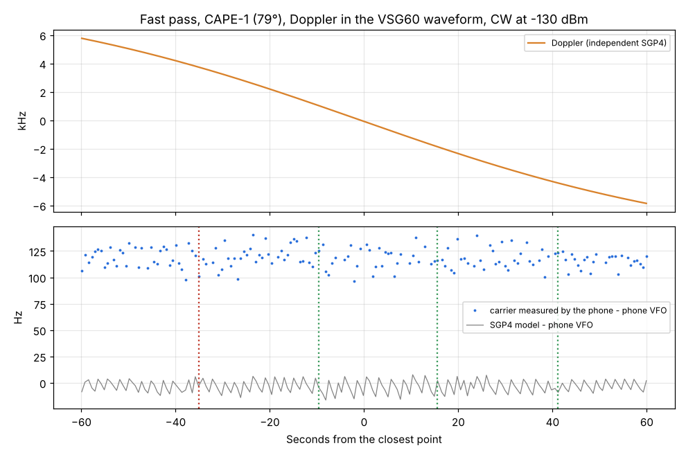

# Fast pass with the Doppler in the waveform: CAPE-1, 79°, up to 116 Hz/s

Run: 2026-11-04 14:47, `tools/lab/fast_pass.py --norad 31130 --level -130`, SatHunterSDR v0.2.0-beta10-lab10
(Doppler tracking with VFO glide). Chain as in [System A2](../2026-11-02_1044_system-a2-mds/report.md)
(RTL gain 12.5 dB, 1.024 MS/s / 8, CW 2 kHz).

How it works (the VSG60 is never retuned; retuning interrupts its output, see
[the LEO pass report](../2026-11-04_1331_pass-sim-leo-lab10/report.md)):
1. The satellite's TLE from SatNOGS and the phone's station go into an independent SGP4 (python `sgp4`,
   TEME -> ECEF by GMST). It gives the frequency the satellite would be heard on during the 120 s around
   the closest point of the phone's next pass: Doppler -5.86 ... +5.78 kHz, up to 116 Hz/s.
2. Keyed CW ("VVV DE HG0LAB TEST", 15 WPM) with that Doppler is written as one ARB file (3 M samples at
   25 kS/s), loaded and held with the RF off.
3. The phone jumps its clock to the pass (Simulate) and tracks it with its own orbit model. When its
   simulated clock reaches TCA - 60 s, the waveform and the RF are switched on (start error 0.05 s).
4. Five times a second: the phone's VFO, and the carrier frequency the phone actually measures.

| Quantity | Result |
|---|---|
| Phone orbit model vs independent SGP4 (range rate, same TLE) | **0.16 Hz** apart at 435 MHz |
| Carrier the phone measures − phone VFO | constant +118 Hz (the RTL / VSG60 reference offset of the day), **±9 Hz (1σ)** through the whole window, ±18 Hz at 95 % |
| SGP4 model − phone VFO | within ±16 Hz (RMS 6.7 Hz) |
| CW decodes at TCA -35, -10, +16, +41 s | text complete in all four (the -35 s window ended mid-copy) |
| C/N0 at the decoder | 42.0-42.6 dB-Hz, no loss at the closest point |

## Findings

1. With fast Doppler (116 Hz/s, the closest point of a 79° LEO pass) the phone keeps the carrier within
   ±9 Hz (1σ) of where it expects it; the spread does not grow with the Doppler rate. The CW decoder sees
   a steady tone and decodes through the closest point.
2. The phone's orbit and Doppler computation agree with an independent SGP4 to 0.16 Hz.
3. The constant +118 Hz is the frequency reference difference between the RTL-SDR (after its ppm
   setting) and the VSG60 that day; it is a fixed offset the CW tracker absorbs.
4. VSG60 note: an ARB at 20 kS/s plays about 16 % slow (measured with a linear chirp: 67 instead of
   80 Hz/s); 25 and 50 kS/s play at the right rate. The first run of this test (at 20 kS/s) drifted off
   the Doppler after the closest point for that reason and was discarded.
