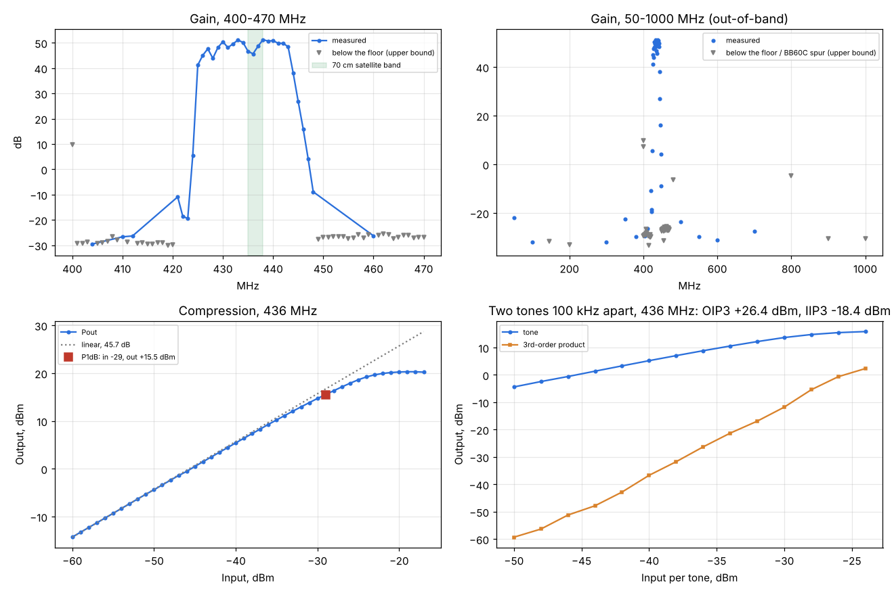

# Spacewalker LNA 434 MHz v1.4: gain, passband, out-of-band rejection, P1dB, IIP3

Runs: 2026-11-04 15:23-15:40, `tools/lab/path_cal.py` and `tools/lab/lna_char.py` (VSG60A + BB60C over its C API).
DUT: Spacewalker LNA 434 MHz v1.4 (Decent Labs Kft.), **5.0 V, 125 mA** from a lab supply through a bias tee.

Setup: VSG60A - 20 dB - long coax - **LNA** - bias tee - 30 dB - BB60C (S/N 19162106, API 5.0.9).
The same path without the LNA was measured first ([path-cal](../2026-11-04_1523_path-cal/results.json):
54.1-55.4 dB in 380-490 MHz, 54.8 dB at 434 MHz); the output side (30 dB pad + bias tee) is taken as 30.5 dB,
so levels are at the LNA's connectors. Raw data: this folder (P1dB, IIP3), [passband](../2026-11-04_1532_spacewalker-lna-passband/results.json),
[out-of-band](../2026-11-04_1535_spacewalker-lna-oob/results.json).

## Results

| Quantity | Result |
|---|---|
| Gain, 70 cm satellite band 435-438 MHz | **45.6-51.2 dB** (45.7 dB at 436 MHz from the compression sweep) |
| Gain, 430-443 MHz | 45.6-51.2 dB, peak 51.2 dB at 438 MHz; ripple about ±2.8 dB |
| Passband edges (gain > 40 dB) | about 425-444 MHz; 4 dB at 447 MHz, 5.5 dB at 424 MHz |
| Rejection vs the passband (50 dB) | 50 MHz 72 dB; 350 MHz 72 dB; 380 MHz 80 dB; 500 MHz 74 dB; 550-700 MHz 77-81 dB |
| Rejection where the tone stayed under the analyser floor | > 80 dB at 100, 145 (2 m), 200, 415, 455, 900 (GSM), 1000 MHz |
| Input P1dB / output P1dB, 436 MHz | **-29 dBm / +15.5 dBm** |
| IIP3 / OIP3, 436 MHz (tones 100 kHz apart, -42...-30 dBm per tone) | **-18.4 dBm / +26.4 dBm** |
| Supply | 5.0 V, 125 mA (0.63 W) |

## Notes

- Readings at exactly 400, 480 and 800 MHz (+7, -6 and -5 dB "gain") are BB60C spurs at multiples of
  80 MHz: they stay with the generator off, sit 45-100 Hz from the nominal frequency (the VSG60's tone
  would be about +0.29 ppm off), and are absent 0.5 MHz either side. They are plotted as upper bounds.
- The ±2.8 dB ripple in the passband (dips near 428, 431 and 435-436 MHz, about 5 MHz apart) may come
  partly from the measurement: mismatch with the long coax, and the path loss interpolated on a 10 MHz grid.
  A VNA S21 sweep would settle it; the lowest point of the satellite band, 45.6 dB at 436 MHz, is
  confirmed independently by the compression sweep.
- Noise figure was not measured here (no noise source); the whole receive chain with this LNA has a
  2.0 dB system noise figure ([System A](../2026-11-02_1028_system-a/report.md)).
- With 45-50 dB of gain the RTL-SDR's ADC, not the LNA, limits the large-signal range of the chain:
  the ADC clips at about -85 dBm at the LNA input (RTL gain 12.5 dB), 56 dB below the LNA's input P1dB.
