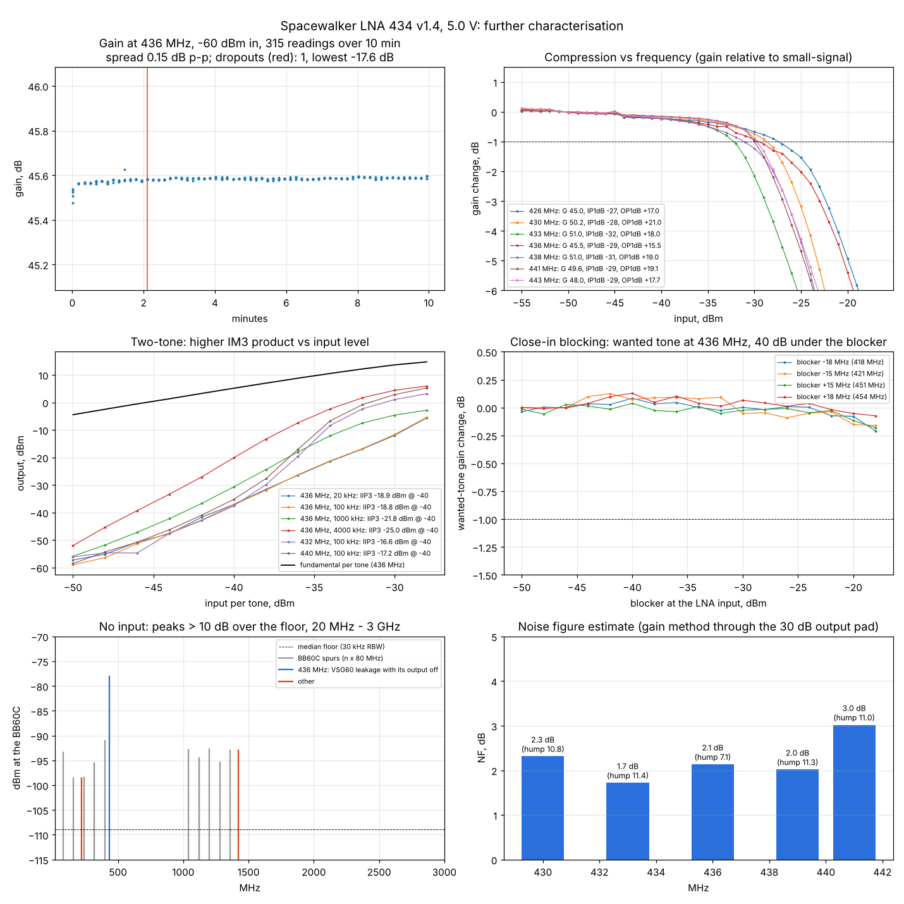

# Spacewalker LNA 434 MHz v1.4: stability, P1dB vs frequency, IIP3 vs spacing, blocking, harmonics, spurs, NF estimate

Runs: 2026-11-04 15:56-16:20, `tools/lab/lna_extra.py`, plots by `tools/lab/plot_lna_extra.py`. Spur scan and NF
were rerun at 16:18 ([lna-spur-nf](../2026-11-04_1618_lna-spur-nf/results.json)) after the first run stopped
on a JSON error at that point (the earlier parts were recovered intact).
DUT and setup as in the [main LNA report](../2026-11-04_1530_spacewalker-lna/report.md): 5.0 V, 125 mA;
VSG60A - 20 dB - long coax - **LNA** - bias tee - 30 dB - BB60C; levels referred to the LNA's connectors with
the [path calibration](../2026-11-04_1523_path-cal/results.json) and 30.5 dB on the output side.

## Results

| Test | Result |
|---|---|
| Gain stability, 436 MHz, 10 min (315 readings) | **0.15 dB peak to peak**; +0.08 dB in the first 10 s after the supply restart, then flat |
| Dropouts (reading 60+ dB low, CW unchanged) | 1 of 315 in the stability run; 17 of 266 P1dB points needed a re-read |
| Input / output P1dB, 426-443 MHz | **IP1dB -27 to -32 dBm, OP1dB +15.5 to +21 dBm** (table below) |
| IIP3 at -40 dBm per tone, 436 MHz | 20 kHz -18.9, 100 kHz -18.8, 1 MHz -21.8, 4 MHz -25.0 dBm |
| IIP3 at -40 dBm per tone, 100 kHz | 432 MHz -16.6, 436 MHz -18.8, 440 MHz -17.2 dBm (OIP3 +26...+33 dBm) |
| Close-in blocking, blocker at 418 / 421 / 451 / 454 MHz | **< 0.25 dB desense** up to a -18 dBm blocker (the generator's limit); 1 dB point not reached |
| Harmonics, 436 MHz fundamental at +5 to +20 dBm out | 2f, 3f **< -64 dBc** (analyser-limited); H2 -70 dBc measured at +5 dBm out |
| Spurious / oscillation, no input, 20 MHz - 3 GHz | **none from the LNA**; all peaks are BB60C spurs at n x 80 MHz, the VSG60's leakage at 436 MHz (output off), and 220 / 1420 MHz (below) |
| Noise figure estimate, 430-441 MHz | **1.7-3.0 dB**, 2.1 dB at 436 MHz (table below; about ±1 dB) |

### Compression vs frequency

| MHz | Gain, dB | IP1dB, dBm | OP1dB, dBm |
|---|---|---|---|
| 426 | 45.0 | -27 | +17.0 |
| 430 | 50.2 | -28 | +21.0 |
| 433 | 51.0 | -32 | +18.0 |
| 436 | 45.5 | -29 | +15.5 |
| 438 | 51.0 | -31 | +19.0 |
| 441 | 49.6 | -29 | +19.1 |
| 443 | 48.0 | -29 | +17.7 |

The output stage sets the limit: OP1dB is +17...+21 dBm except at the 436 MHz dip, where the lower gain
in front of the last stage (the ripple) brings it to +15.5 dBm.

### Noise figure estimate

| MHz | Gain, dB | Output noise hump over the floor, dB | NF, dB |
|---|---|---|---|
| 430 | 49.6 | 10.8 | 2.3 |
| 433 | 50.8 | 11.4 | 1.7 |
| 436 | 45.5 | 7.1 | 2.1 |
| 439 | 50.4 | 11.3 | 2.0 |
| 441 | 49.1 | 11.0 | 3.0 |

Gain method: with no signal, the input sees the 20 dB pad (a 290 K termination). The LNA's output noise
density N = k T0 F G is the in-band density measured by the BB60C (power-averaged, 10 kHz flat-top RBW)
minus the floor measured out of band (400, 410, 460, 470 MHz: the analyser's own noise plus the output
pad's thermal noise; the LNA adds nothing there), plus the 30.5 dB output loss. Gain per frequency is
taken from the [comb sweep](../2026-11-04_1546_lna-comb/results.json). With the 30 dB pad in place the hump
is only 7-11 dB, so the floor correction and the analyser's noise-level accuracy give about ±1 dB.
For comparison, the whole RTL-SDR chain with this LNA measured 2.0 dB
([System A](../2026-11-02_1028_system-a/report.md)).

## Notes

- **Dropouts.** In a few readings the tone drops 60+ dB (gain -17.6 dB once in the stability run) while
  nothing changes on the generator side. They are short (the next reading 0.5 s later is normal) and
  occurred also in the earlier r2 run after the supply restart. The source is not settled yet (LNA supply,
  bias-tee contact, VSG60 output blanking or a BB60C sweep glitch); a VSG60 - BB60C run without the LNA
  will separate it. The scripts now re-read any point more than 3 dB off its neighbour.
- **IIP3 vs spacing.** The IM3 slope is 2.4-2.5 at 20 and 100 kHz and 2.9-3.3 at 1 and 4 MHz, so the
  IIP3 is quoted at -40 dBm per tone. The lower IIP3 at 1-4 MHz spacing is not separated from the
  generator's own two-tone IMD (the VSG60 makes the pair from one 10-40 MS/s ARB); a thru measurement
  without the LNA would bound it. At 100 kHz the result agrees with the earlier run (-18.4 dBm).
- **Blocking.** The input SAW does its job: blockers 15-18 MHz away (418-454 MHz) up to -18 dBm cause
  < 0.25 dB loss of a wanted tone 40 dB lower. Stronger blockers and out-of-band ones (2 m band, GSM 900)
  need a second generator or an external amplifier.
- **Harmonics.** The analyser's reference level has to follow the fundamental (up to +20 dBm at the LNA
  output, -10 dBm at the BB60C), which puts the floor at about -65 dBc; the LNA's harmonics are below it
  except at +5 dBm out (H2 -70 dBc). A notch or high-pass in front of the BB60C would extend this.
- **Spur scan.** 220.0 MHz (DAB band III) and 1420 MHz are 15 dB over the floor at the analyser, about
  -62 dBm referred to the LNA output; they are outside the LNA's passband and most likely pickup on the
  long coax / analyser rather than the LNA. Nothing in the 380-490 MHz range apart from the VSG60's leakage
  tone, so no sign of oscillation.

## Still to do (needs reconnection)

- Noise figure without the output pad (larger hump, ±0.3 dB).
- Reverse isolation S12 (ports swapped).
- Gain and current vs supply voltage (4.5 / 5.0 / 5.5 V).
- VSG60 - BB60C without the LNA: the dropouts and the generator's two-tone IMD.
