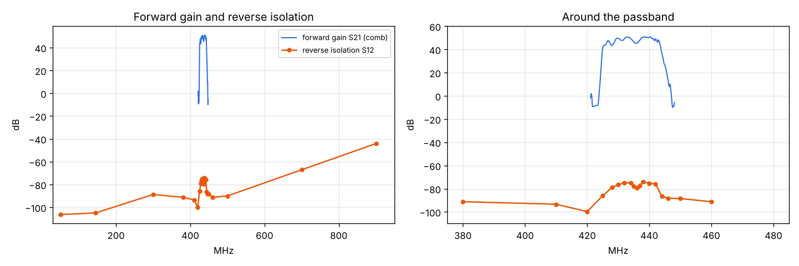

# Spacewalker LNA 434 MHz v1.4: reverse isolation (S12)

Run: 2026-11-05 10:53, `tools/lab/path_cal.py --level 8 --ref -60` with the LNA reversed:
VSG60A - 20 dB - coax - bias tee - **LNA OUT ... LNA IN** - BB60C (no pad), 5.0 V / 131 mA on the board.
S12 = BB60C reading - VSG level + input path ([input-path-cal](../2026-11-05_1031_input-path-cal/results.json), 23.2-23.7 dB)
+ 1.0 dB for the bias tee and cable (±0.5 dB). Outside 380-480 MHz the input path is taken from the full path
calibration minus the output side (31.1 dB). Raw data: [results.json](results.json), per-point S12: [s12.json](s12.json),
plot: [plot.py](plot.py).

| Range | S12 | S21 + S12 (loop) |
|---|---|---|
| Passband 430-442 MHz | **-74 ... -79 dB** | -24 ... -34 dB |
| 425 / 444-446 MHz (skirts) | -86 / -86 ... -88 dB | - |
| 380-420, 450-500 MHz | -84 ... -100 dB | -104 ... -120 dB |
| 50 / 145 MHz | -106 / -105 dB (12-20 dB over the floor) | - |
| 300 MHz | -89 dB | - |
| 700 MHz | -67 dB | - |
| 900 MHz | **-44 dB** | - |

Readings at exactly 400 and 480 MHz are BB60C spurs (multiples of 80 MHz) and are left out of the plot.

## Findings

1. In the passband the LNA isolates its output from its input by 74-79 dB. Anything the receiver behind it
   radiates back (the RTL-SDR's LO and clock harmonics) reaches the antenna at least 74 dB down, and the
   product S21·S12 stays at -24 dB or lower: no feedback path for instability through the device itself
   (S11 / S22 still to be measured for a full stability factor).
2. Reverse isolation follows the passband shape: the reverse path also goes through the SAW filters.
3. At 900 MHz the reverse path is only 44 dB, against more than 70 dB of forward rejection: some coupling
   that bypasses the gain stages (board layout or a SAW's out-of-band leakage). Harmless for reception
   (the forward path is what matters), but a GSM-900 signal on the receiver side leaks back to the antenna
   at -44 dB.
