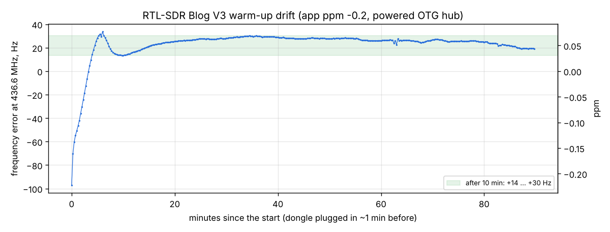

# RTL-SDR warm-up drift after plugging in (powered OTG hub)

Run: 2026-11-05 11:48-13:18, `tools/lab/drift.py --level -95 --mins 90 --every 15`. RTL-SDR Blog V3 on the Mi 10 through
a **powered OTG hub** (the phone charges during the run), bias tee on, 1.024 MS/s / 8, gain 12.5 dB, ppm correction
-0.2 in the app. The dongle was plugged in about a minute before the start (a cold start). The VSG60A plays a CW
carrier at 436.6 MHz; the phone measures its offset every 15 s. Raw data: [results.json](results.json), plot: [plot.py](plot.py).

| Time after the start | Error at 436.6 MHz |
|---|---|
| 0 min | -97 Hz (-0.22 ppm) |
| 1 / 2 min | -51 / -30 Hz |
| 5-6 min | +28 ... +34 Hz (peak) |
| 10-90 min | +13 ... +29 Hz, the last 30 min within 8 Hz |

## Findings

1. The TCXO warms up in about **5 minutes**: 130 Hz (0.3 ppm) at 436 MHz, then a small overshoot and a slow settle.
2. After 10 minutes the frequency stays within ±8 Hz: well inside a CW filter and the APRS channel, and small
   against the satellite's own transmitter offset (often 1-2 kHz).
3. **Practice for a pass: plug the dongle in at least 5-10 minutes before AOS.** A pass started from cold drifts
   by up to 130 Hz in its first minutes (at 435 MHz), which a 2 kHz CW filter tolerates but a narrow one may not.
4. The powered hub caused no problem: SNR 70 dB throughout, no dropped blocks.
