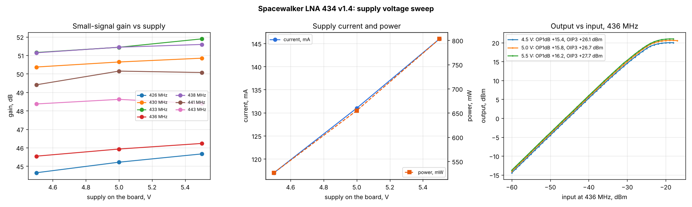

# Spacewalker LNA 434 MHz v1.4: supply voltage sweep (4.5 / 5.0 / 5.5 V)

Runs: 2026-11-05 09:19, 09:39, 10:09, `tools/lab/lna_char.py --parts gain,p1db,ip3 --freqs 426,430,433,436,438,441,443 --pins -60`,
summary by `tools/lab/plot_supply.py`. Setup as in the [main LNA report](../2026-11-04_1530_spacewalker-lna/report.md)
(VSG60A - 20 dB - coax - LNA - bias tee - 30 dB - BB60C). Raw data: [4.5 V](../2026-11-05_0919_lna-supply-4.5V/results.json),
[5.0 V](../2026-11-05_0939_lna-supply-5.0V/results.json), [5.5 V](../2026-11-05_1009_lna-supply-5.5V/results.json); [summary.json](summary.json).

Voltages are **measured on the LNA board**; the lab supply had to be set 0.22-0.24 V higher (5.22 V for
5.0 V, 5.74 V for 5.5 V) because of the drop in the leads and the bias tee (about 1.7 Ω). The runs of
2026-11-04 ("5.0 V, 125 mA") had 5.0 V at the supply, about 4.8 V on the board.

| On the board | Current | Power | Gain 436 MHz | Gain 426-443 MHz | IP1dB / OP1dB (436 MHz) | Max output | IIP3 / OIP3 (436 MHz, -40 dBm/tone) |
|---|---|---|---|---|---|---|---|
| 4.5 V | 117 mA | 527 mW | 45.5 dB | 44.6-51.2 dB | -29 / +15.4 dBm | +20.0 dBm | -19.0 / +26.1 dBm |
| 5.0 V | 131 mA | 655 mW | 45.9 dB | 45.2-51.4 dB | -29 / +15.8 dBm | +20.6 dBm | -18.8 / +26.7 dBm |
| 5.5 V | 146 mA | 803 mW | 46.2 dB | 45.7-51.9 dB | -29 / +16.2 dBm | +21.0 dBm | -18.1 / +27.7 dBm |

## Findings

1. The LNA is insensitive to its supply: from 4.5 to 5.5 V the gain rises 0.5-1.0 dB, OP1dB 0.8 dB,
   OIP3 1.6 dB; the passband shape (ripple) does not change. Current rises linearly, 29 mA/V
   (about 34 Ω incremental).
2. 4.5 V is enough for full performance; 5.0 V on the board is the nominal point. With a long or thin
   bias-tee feed, compensate the drop (here 0.22 V at 131 mA) or the board runs at ~4.8 V, which costs
   only ~0.2 dB of gain.
3. Dropouts (a reading 60+ dB low) happened at -17 dBm input at 4.5 and 5.5 V, and once at -38 dBm
   input at 5.5 V; they are left out of the P1dB evaluation. The [thru check](../2026-11-05_0856_thru-check/report.md)
   shows they do not come from the instruments.
