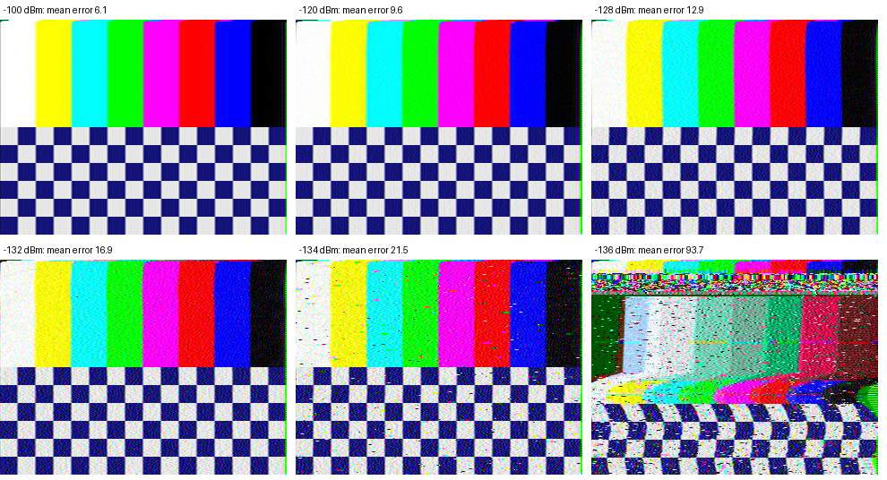
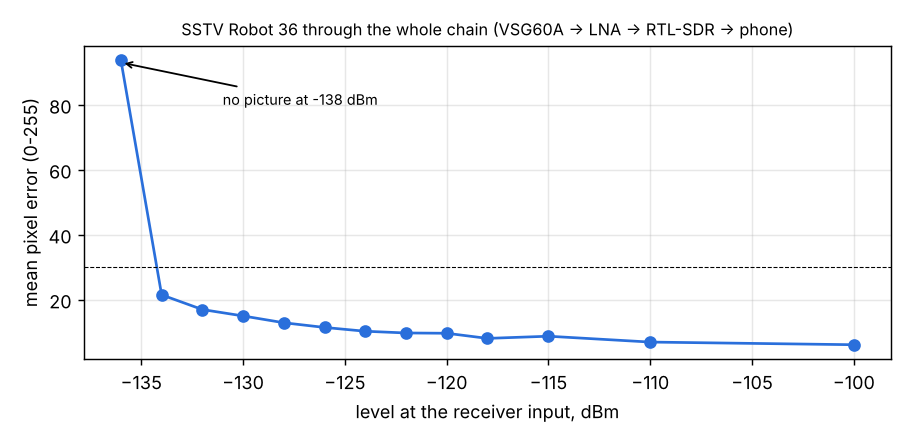

# SSTV (Robot 36) through the whole receive chain

Runs: 2026-11-05 13:59-14:20, `tools/lab/sstv_test.py`, SatHunterSDR v0.2.0-beta10-lab11 (first build with the SSTV
decoder). Chain as in [System A2](../2026-11-02_1044_system-a2-mds/report.md): VSG60A - attenuators (34.7 dB) - Spacewalker
LNA 434 - RTL-SDR V3 (gain 12.5 dB, 1.024 MS/s / 8, powered OTG hub) - Mi 10; NFM 12.5 kHz at 436.6 MHz.

The VSG60A plays a Robot 36 picture (colour bars over a checkerboard, VIS header included), FM with 3 kHz deviation, from a
25 kS/s ARB that loops; the phone's SSTV decoder (`sh-dsp/src/sstv.rs`) finds the VIS code, locks each line on its sync
pulse and builds the picture; the script fetches it (`/sstv.ppm`) and compares it with the original (mean absolute
pixel error, 0-255, away from the edges). Raw data and every received picture:
[run 1](../2026-11-05_1359_sstv-robot36/results.json), [run 2](../2026-11-05_1407_sstv-robot36-low/results.json),
[run 3](../2026-11-05_1413_sstv-robot36-limit/results.json).

> **Caveat (2026-11-07):** with a HackRF at home the same test needs about 12 dB more signal, while APRS from the same
> chain agrees with the lab. These levels may be optimistic (VSG60A level at a 25 kS/s ARB?); to be checked with the BB60C.
> See [the home HackRF report](../2026-11-07_home-hackrf/report.md).

| Level at the receiver input | Mean pixel error | Picture |
|---|---|---|
| -100 ... -120 dBm | 6.1 ... 9.6 | clean |
| -122 ... -128 dBm | 9.7 ... 12.9 | clean |
| -130 / -132 dBm | 15.0 / 16.9 | clean, light speckle |
| -134 dBm | 21.5 | usable, speckle and a few dropped pixels |
| -136 dBm | 93.7 | VIS decoded, line sync lost in the first lines, wrong colours |
| -138 dBm | - | no VIS header found |

The -122 dBm point of run 1 was taken while the PC was at 93 % CPU (the VSG60A output has gaps then) and is replaced by
run 2.

## Findings

1. Robot 36 decodes cleanly down to **-132 dBm** and usably to **-134 dBm**, about 12 dB under the APRS 90 % point
   (-122.5 dBm): SSTV degrades gracefully into noise instead of failing on a single bit.
2. The decoder found every picture's VIS header and kept line sync on every line down to -134 dBm; no horizontal shift
   (cross-correlation with the original: 0 px at -100 dBm, -1 px at -120 dBm).
3. The failure at -136 dBm starts with the line timing in the first lines (the loop trusts the first syncs most) and
   the R-Y / B-Y line order (decided from the separator tone). Both can be made more robust: the next step if weak ISS
   events need it.
4. Simulation (`cargo run --release --example sstv_sim`) and the lab agree on the picture quality at high levels
   (error 6-7); the lab chain reaches lower levels than the simulation predicts, because its NFM demodulator and
   noise model differ from the simulated ones.
