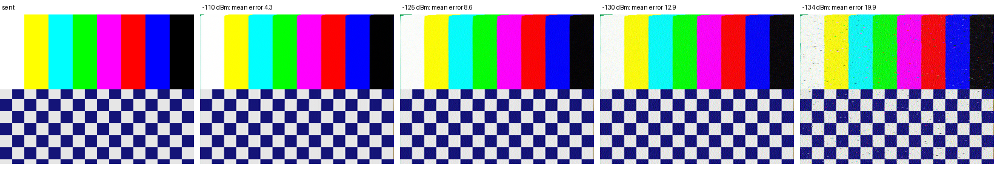

# SSTV PD120 through the whole receive chain

Run: 2026-11-06 08:32-08:41, `tools/lab/sstv_test.py --mode pd120`, SatHunterSDR v0.2.0-beta10-lab12. Chain as in the
[Robot 36 run](../2026-11-05_sstv-summary/report.md): VSG60A - 34.7 dB - Spacewalker LNA 434 - RTL-SDR V3 (gain 12.5 dB,
1.024 MS/s / 8) - Mi 10, NFM 12.5 kHz at 436.6 MHz. The VSG60A plays a 640 x 496 PD120 picture (VIS 95, 127 s, FM 3 kHz
deviation, 25 kS/s ARB looping). Raw data and the received pictures: [results.json](results.json).

| Level at the receiver input | Mean pixel error (0-255) |
|---|---|
| -110 dBm | 4.3 |
| -125 dBm | 8.6 |
| -130 dBm | 12.9 |
| -134 dBm | 19.9 |

PD120 decodes at every level down to -134 dBm, with errors close to Robot 36 at the same levels (Robot 36: 15.0 at
-130, 21.5 at -134 dBm): its 20 ms sync and its four times longer pixels make it a little more robust, as expected.
