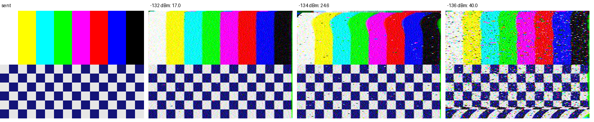

# SSTV Robot 36 at the sensitivity limit: lab11 vs lab15 (sync re-acquisition)

Run: 2026-11-06 09:41-09:47, `tools/lab/sstv_test.py --mode robot36 --levels=-132,-134,-136,-137,-138`,
SatHunterSDR v0.2.0-beta10-lab15 on the Mi 10. Chain and settings as in the
[SSTV summary](../2026-11-05_sstv-summary/report.md): VSG60A - 34.7 dB - Spacewalker LNA 434 - RTL-SDR V3
(gain 12.5 dB) - powered OTG hub - Mi 10, NFM 12.5 kHz at 436.6 MHz, FM 3 kHz deviation. Raw data: [results.json](results.json).

lab15 adds line-sync re-acquisition to the decoder: after 3 missed syncs it searches a whole line period for the
sync pulse and restarts the timing loop from there.

| Level at the receiver input | lab11 (2026-11-05) | lab15 (this run) |
|---|---|---|
| -132 dBm | 16.9 | 17.0 |
| -134 dBm | 21.5 | 24.6 |
| -136 dBm | 93.7, wrong colours, sync lost | **40.0, picture recognisable** |
| -137 dBm | - | no VIS header |
| -138 dBm | no VIS header | no VIS header |

Mean pixel error, 0-255, against the sent picture.

## Findings

1. Re-acquisition moves the limit for a recognisable picture from -134 to **-136 dBm** (about 2 dB). The -136 dBm
   picture keeps its line timing to the bottom; the errors left are noise speckle and short sync slips that the loop
   recovers within a few lines.
2. -132 and -134 dBm are unchanged within the run-to-run spread (one picture per level; the -134 dBm picture shows a
   few bent lines near the top where the loop settles, then holds).
3. The limit is now the VIS header (-137 dBm): no header, no picture. A manual mode start or a VIS search over a
   longer window would be the next step if the last 1-2 dB matter.
