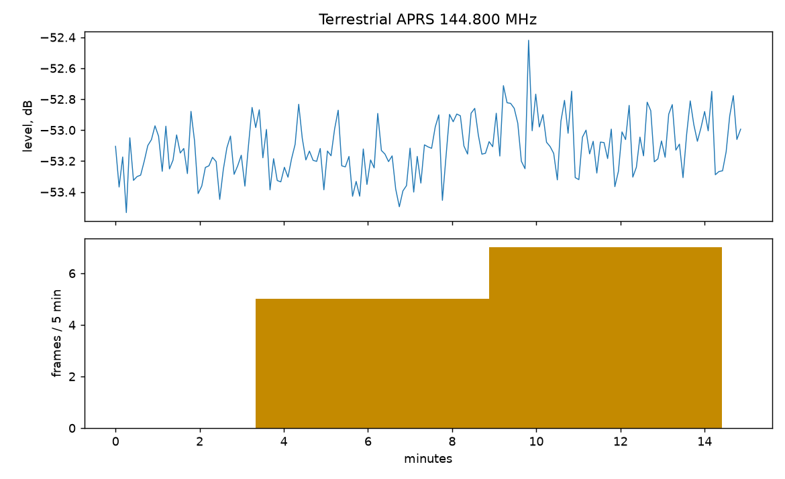
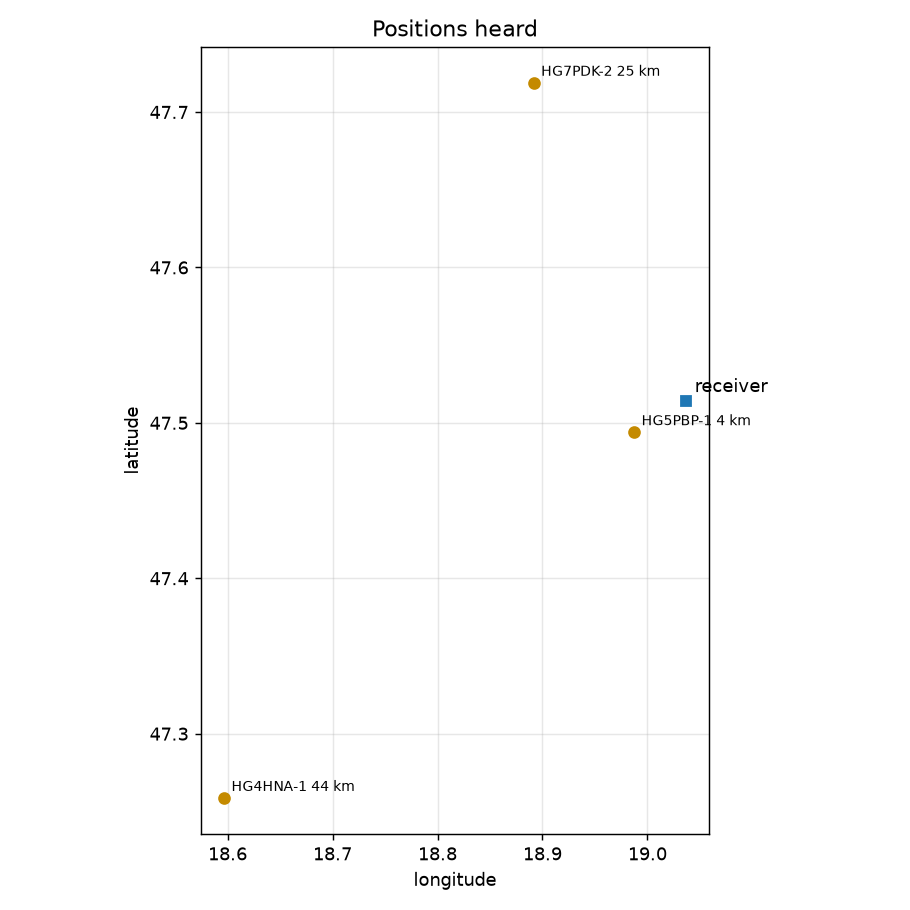

# Terrestrial APRS field log

Run: 2026-11-06 16:35, 15 min, `tools/lab/aprs_log.py`, source rtl, 144.800 MHz NFM, gain 40.06395721435547 dB, decimation 8.

| | |
|---|---|
| Frames (good CRC) | 12 (48 per hour) |
| Stations heard (source calls) | 4 |
| Heard direct / via a digipeater | 5 / 7 |
| Bad-CRC flags (noise and broken frames) | 415 |
| Signal level (channel), median / max | -53.1 / -52.4 dB |
| Dropped blocks | 0 |

## Packet types

| Type | Frames |
|---|---|
| position (time) | 6 |
| telemetry | 5 |
| Mic-E | 1 |

## Stations

| Station | Frames | Position | Distance, bearing |
|---|---|---|---|
| HG5PBP-1 | 5 | 47.4938, 18.9875 | 4.3 km, 239° |
| HG4HNA-1 | 4 | 47.2585, 18.5968 | 43.6 km, 230° |
| HG7PDK-2 | 2 | 47.7187, 18.8918 | 25.2 km, 335° |
| HA5UDS-7 | 1 | - | - |

## Digipeaters (frames repeated by)

| Digipeater | Frames |
|---|---|
| HG5PBP-1 | 7 |
| WIDE1 | 1 |

All frames: [frames.jsonl](frames.jsonl); receiver status every 5 s: [status.csv](status.csv).
