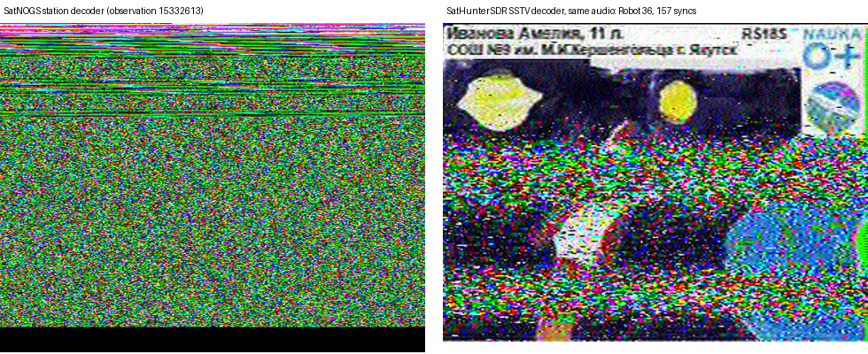

# Decoders on real satellite recordings (SatNOGS)

2026-11-06. Four SatNOGS observations (demodulated audio as the stations recorded it), decoded offline by the
SatHunterSDR chains (`sh-dsp` examples `aprs_wav`, `sstv_wav`) and compared with what each station's own decoder
uploaded. The cut segments are now test vectors in CI: [testdata/satnogs](../../core/crates/sh-dsp/testdata/satnogs/README.md).

## AFSK1200 / AX.25

| Observation | Satellite | SatNOGS frames | SatHunterSDR, discriminator only | SatHunterSDR, merged detectors |
|---|---|---|---|---|
| [15339570](https://network.satnogs.org/observations/15339570/) | ISS 437.825 MHz | 2 | 1 | 2 |
| [15372907](https://network.satnogs.org/observations/15372907/) | NORAD 68795 | 24 | 18 | 29 |
| [15370705](https://network.satnogs.org/observations/15370705/) | PCSAT 144.39 MHz | 15 | 21 | 21 |

Whole passes, frames with a good CRC (bit-repaired ones included). SatHunterSDR found every frame SatNOGS found on
ISS and PCSAT, and 22 of 24 on 68795.

The lab-tuned discriminator (650 Hz low-pass after mixing to 1700 Hz) is the best detector on the simulated FM
channel, but real audio differs from station to station in twist, de-emphasis and bandwidth: on 68795 the tone
detector decodes 25 frames where the discriminator gets 18, on the ISS beacon a wide (3 kHz) low-pass wins. The
decoder now runs all three detectors on the same audio and reports each frame once (same bytes within 1 s): it
is never worse than the best of them, and on the simulated channel it moves the 49 dB-Hz point from 85 % to 92 %
packets ([aprs_sim](../../core/crates/sh-dsp/examples/aprs_sim.rs), 40 packets per point).

## SSTV

[15332613](https://network.satnogs.org/observations/15332613/), RS18S on 437.35 MHz: the station's SSTV decoder lost
this picture; the SatHunterSDR decoder (with the line-sync re-acquisition from lab15) decodes the whole Robot 36
picture from the same audio.

SatNOGS data: CC BY-SA 4.0, credit to the station owners (DB0RBX, JA1HCB, KI5YNG, PE0SAT).
