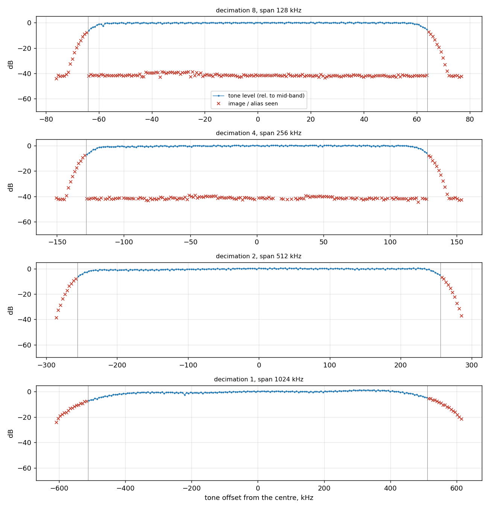

# Panorama sweep: the app's spectrum across the span

Generator hackrf, -100.0 dBm at the receiver, 2026-11-07 02:49:47. A CW tone stepped across the span and 10 % beyond; the phone's display spectrum read at each step.

| Decimation | Span | Flat (±1 dB) | -3 dB edges | Worst image / alias (dB below the tone) |
|---|---|---|---|---|
| 8 | 128 kHz | -58 ... +58 kHz | -61 ... +61 kHz | 36 |
| 4 | 256 kHz | -115 ... +117 kHz | -121 ... +123 kHz | 35 |
| 2 | 512 kHz | -224 ... +240 kHz | -246 ... +249 kHz | none above 6 dB |
| 1 | 1024 kHz | -375 ... +449 kHz | -449 ... +479 kHz | none above 6 dB |

Raw data: [results.json](results.json).
