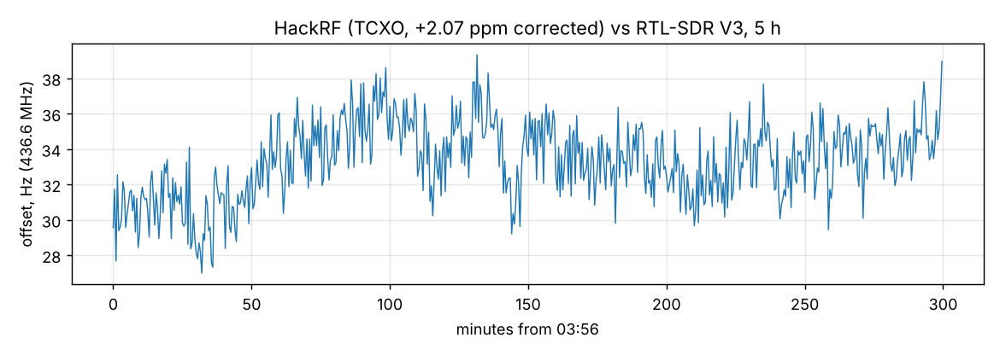

# 5-hour frequency drift: HackRF generator vs the RTL-SDR (home, night)

2026-11-07 03:56-08:56, `tools/lab/drift.py --gen hackrf`, CW at 436.6 MHz, -100 dBm at the LNA input, a reading every
30 s (600 readings). The HackRF (TCXO) runs with the +2.07 ppm correction from the
[receiver calibration](../2026-11-07_home-hackrf/report.md); the phone's RTL-SDR V3 with its -0.2 ppm setting.
Both were warm (running for hours before).

| | |
|---|---|
| Offset seen by the phone | +27.0 ... +39.3 Hz, median +33.4 Hz (+0.077 ppm) |
| Spread | 2.2 Hz rms, 12 Hz peak to peak over 5 h |
| SNR | 52 dB throughout |

The two references agree within 0.08 ppm and move together by less than 0.03 ppm over the night: for NFM, APRS
and SSTV tests the HackRF needs no retuning after warm-up, and the 33 Hz residue is negligible (the decoders
track a few hundred Hz). Raw data: [results.json](results.json).
