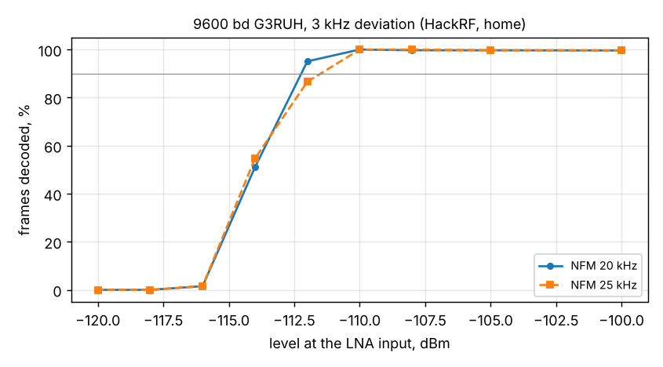

# 9600 bd G3RUH FSK: frame success vs level (HackRF, home)

2026-11-07 16:24, `tools/lab/rx_extra.py --gen hackrf --part g3ruh`, SatHunterSDR v0.2.0-beta11-lab20 (first 9k6
decoder). Chain and calibration as in the [home HackRF report](../2026-11-07_home-hackrf/report.md): HackRF ->
70.5 dB -> Spacewalker LNA -> RTL-SDR V3 (gain 12.5 dB, 1.024 MS/s / 8) -> Mi 10; levels at the LNA input (+-2 dB).
Waveform: 10 AX.25 UI frames of 80 bytes per 1.55 s loop, G3RUH scrambled, raised-cosine NRZ (roll-off 0.5),
FM +-3 kHz, 436.6 MHz; 20 s per level.

| Level | NFM 20 kHz | NFM 25 kHz |
|---|---|---|
| -110 dBm | 100 % | 100 % |
| -112 dBm | 95 % | 87 % |
| -114 dBm | 51 % | 55 % |
| -116 dBm | 2 % | 2 % |

- **90 % of the frames at about -112.5 dBm** (20 kHz channel); 25 kHz is no better.
- With the home receiver's noise (C/N0 = level + 170.3 dB, from the same evening's CW checks) that is about
  57.8 dB-Hz, Eb/N0 about 18 dB. The simulation of the same decoder (`g3ruh_sim`, white noise, 20 kHz IF) reaches
  90 % at about 52.5 dB-Hz: **about 5 dB of implementation loss** in the real chain, against about 2 dB for AFSK
  1200. Suspects: the slow clock loop chosen for the SatNOGS recordings (0.05; 0.25 was 0.5 dB better in the
  simulation), the channel filter and decimation ahead of the discriminator, no matched filter. Next step: record
  the phone's discriminator output at -114 dBm and tune offline.
- APRS (AFSK 1200) from the same chain reaches 90 % at -119 dBm: 9k6 needs about 6.5 dB more signal, close to the
  8 x bit rate (9 dB) less the larger deviation's gain.
