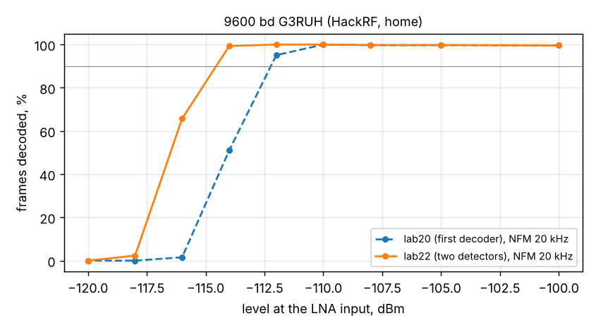

# 9600 bd G3RUH: frame success with the retuned decoder (lab22)

2026-11-07 18:29, same chain and waveform as the [first run](../2026-11-07_1624_g3ruh-hackrf/report.md) (HackRF -> 70.5 dB
-> LNA -> RTL-SDR -> Mi 10, levels at the LNA input +-2 dB), SatHunterSDR v0.2.0-beta11-lab22.

| Level | lab20, NFM 20 kHz | lab22, NFM 20 kHz | lab22, NFM 25 kHz |
|---|---|---|---|
| -112 dBm | 95 % | 100 % | 100 % |
| -114 dBm | 51 % | 99 % | 93 % |
| -116 dBm | 2 % | 66 % | 62 % |
| -118 dBm | 0 % | 2 % | 2 % |

**90 % of the frames at about -114.8 dBm, 2.3 dB better than lab20** (-112.5 dBm). That is about 55.5 dB-Hz with
the home receiver's noise, 3 dB from the simulation (52.5 dB-Hz): the rest is the receiver's own noise shaping and
filters, comparable to AFSK 1200's 2 dB.

How it was found: the phone's FM discriminator recorded through the lab link (`/fm`, 64 kHz, `tools/lab/fm_record.py`)
at -108 ... -116 dBm and decoded offline. The first decoder had been tuned on SatNOGS audio, which is already
filtered; on the phone's wide discriminator its wide low-pass (0.7 x baud) let in the FM noise that rises with
frequency. Now two detectors run (low-pass 0.55 x baud / clock gain 0.1, and the SatNOGS setting 0.7 / 0.05)
and each frame is reported once. Offline on the same recordings: -114 dBm 189 of 193 frames (97 before),
-116 dBm 119 (3 before). A 12 s piece of the -114 dBm recording is a CI test vector
(`sh-dsp/testdata/satnogs/phone_fm_g3ruh9k6_114dBm.ogg`).
