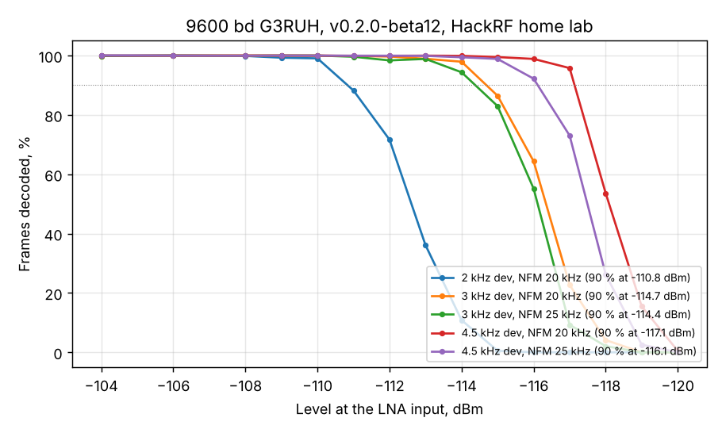

# 9600 bd G3RUH on the release build: level and FM deviation (beta 12)

> **Level correction (2026-11-09):** the HackRF levels in this report are 1.8-2.1 dB too high; the BB60C calibration ([2026-11-09_1009](../2026-11-09_1009_hackrf-cal-bb60c/report.md)) shows the signal at the LNA was weaker, so sensitivities are about 2 dB better than written here.

2026-11-07 22:53-23:36, unattended (`tools/lab/night_m10.ps1`). Chain: HackRF -> 30+30+10 dB -> 1 m coax ->
Spacewalker LNA -> RTL-SDR V3 (gain 12.5 dB) -> Mi 10, SatHunterSDR **v0.2.0-beta12** (release APK).
Levels at the LNA input, +-2 dB (HackRF calibrated through the receiver, BB60C check pending). 10 AX.25
frames per 1.55 s loop, 30 s per level (about 194 frames), 1 dB steps.

Raw data: this folder, [2026-11-07_2310_g3ruh-beta12-dev2k](../2026-11-07_2310_g3ruh-beta12-dev2k/results.json)
and [2026-11-07_2319_g3ruh-beta12-dev4k5](../2026-11-07_2319_g3ruh-beta12-dev4k5/results.json).

| FM deviation | NFM 20 kHz, 90 % frames | NFM 25 kHz, 90 % frames |
|---|---|---|
| 2 kHz | -110.8 dBm | - |
| 3 kHz | -114.7 dBm | -114.4 dBm |
| 4.5 kHz | **-117.1 dBm** | -116.1 dBm |

- The release build matches the lab22 build (-114.8 dBm at 3 kHz, NFM 20 kHz): the merged detectors made it
  into beta 12 intact.
- Deviation matters as FM theory says: 2 kHz costs 3.9 dB, 4.5 kHz gains 2.4 dB against 3 kHz. Real 9k6
  satellites run 3-4.5 kHz, so expect -115 ... -117 dBm on the air with this chain.
- NFM 20 kHz is the better default even at 4.5 kHz deviation (Carson bandwidth 2 x (4.5 + 4.8) = 18.6 kHz):
  25 kHz only lets in more noise. Keep 20 kHz; it also leaves room for about +-1 kHz of residual Doppler.
- Fall-off is steep: 99 % to 5 % in about 3 dB, typical of a threshold-limited FM discriminator.
