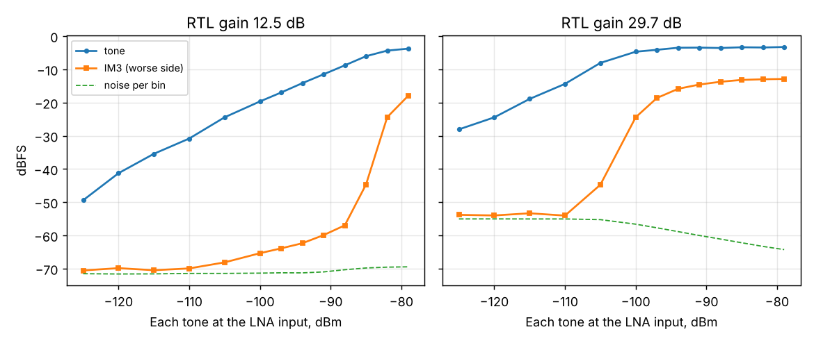

# Two-tone in-band intermodulation (HackRF)

2026-11-07 23:52, same chain as the [9k6 run](../2026-11-07_2253_g3ruh-beta12/report.md), beta 12. Two equal
tones 10 kHz apart, levels per tone at the LNA input, USB, RTL gain 12.5 and 29.7 dB.

- **Gain 12.5 dB:** IM3 comes out of the noise around -105 dBm per tone and stays at least 48 dB below the
  tones up to -94 dBm. At -85 dBm the tones reach -6 dBFS and the 8-bit ADC clips: IM3 jumps by 12 dB per
  3 dB step. Usable in-band range: about -125 ... -88 dBm per tone.
- **Gain 29.7 dB:** the tones reach -8 dBFS at -105 dBm and clip right after. 20 dB less headroom for 17 dB
  more gain: use 12.5 dB when strong terrestrial signals are near.
- Below clipping the IM3 rises about 1 dB per dB, not 3: it is most likely not the receiver's third-order product but the
  HackRF's own (8-bit DAC, digital scaling). So these numbers are a floor for the receiver's linearity, not
  its IIP3. A clean source (VSG60 + combiner) is needed for the real IIP3.
- The tone levels are only roughly linear at the lowest settings (-125 -> -120 dBm reads 8 dB, not 5): at
  -125 dBm the HackRF waveform is down to a few LSB. Low-level HackRF points are +-3 dB.
