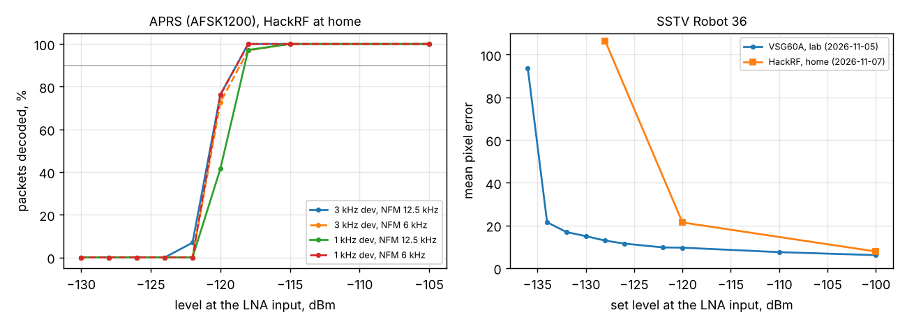

# Home lab with a HackRF: calibration, panorama, APRS and SSTV (2026-11-07 night)

> **Level correction (2026-11-09):** the HackRF levels in this report are 1.8-2.1 dB too high; the BB60C calibration ([2026-11-09_1009](../2026-11-09_1009_hackrf-cal-bb60c/report.md)) shows the signal at the LNA was weaker, so sensitivities are about 2 dB better than written here.

First unattended measurements away from the lab. The VSG60A was replaced by a HackRF One (TCXO, firmware 2026.01.3) on
a second PC (HP ProBook, `tools/lab/setup_probook.ps1`), driven over SSH/ZeroTier from the lab PC.

```
HackRF One -- 30 + 30 + 10 dB -- 1 m coax -- Spacewalker LNA 434 (bias tee) -- RTL-SDR V3 (black) -- Mi 10 (lab18)
```
Levels are at the LNA input (as in the lab runs). RTL gain 12.5 dB, 1.024 MS/s, decimation 8 unless noted.

## 1. Level calibration with the receiver as the transfer standard

No BB60C at home, so the phone itself was the reference: the VSG60A run of 2026-11-02 ([System A](../2026-11-02_1028_system-a/report.md))
fixed its scale (peak dBFS = level at the LNA input + 80.0 dB at gain 12.4 dB, 1.00 dB/dB). Two runs of
`hackrf_rxcal.py` ([data](../2026-11-07_0231_hackrf-rxcal/results.json)):

| | Result |
|---|---|
| HackRF output, TX VGA 0, full scale, via the 70.5 dB chain | P0 = -45.6 dBm (two runs within 0.3 dB) |
| TX VGA law | 1.00 dB/dB from 4 to 32 dB, +-0.5 dB |
| Frequency | +2.07 ppm (+902 Hz at 436.6 MHz), corrected in the generator; +30 Hz left |
| RF amplifier on | 30 dB *less* signal: not used |
| Uncertainty | about +-2 dB (VSG60 level, LNA gain 46.8 dB at 436.6 MHz, another RTL dongle) |

Checks: CW and a 3 kHz FM waveform at the same set level give the same channel power; the idle HackRF (any TX
gain, LO in or out of the band) does not raise the receiver's floor; no spur in the channel. The BB60C closes the
calibration on Monday (`hackrf_cal.py`).

The receiver's floor at home is 2.9 dB higher than in the lab (-71.7 vs -74.6 dBFS per 31 Hz bin at gain 12.5 dB),
so every threshold below is about 3 dB worse than the lab's for that reason alone.

## 2. Panorama: [pano-sweep report](../2026-11-07_0249_pano-sweep/report.md)

| Decimation | Span | Flat (+-1 dB) | -3 dB |
|---|---|---|---|
| 8 | 128 kHz | +-58 kHz | +-61 kHz |
| 4 | 256 kHz | +-116 kHz | +-122 kHz |
| 2 | 512 kHz | -224 ... +240 kHz | +-248 kHz |
| 1 | 1024 kHz | -375 ... +449 kHz | -449 ... +479 kHz |

- Signals just outside the span fold in: -8 dB at the edge, about -30 dB 8 kHz further out (decimation 8);
  at decimation 1 (the RTL2832's own filter) only -5 ... -24 dB. The decimator's stop band needs to start closer
  to the edge, or the display should blank the outer 5 %.
- Every tone carries sidebands at +-36.6 kHz, -40 dBc, at every decimation: from the HackRF or from the receiver's
  supply (OTG hub). The VSG60A will tell which.
- At decimation 1 the span edges are asymmetric (the low side falls 75 kHz earlier): the R820T IF filter.

## 3. APRS (AFSK1200): [3 kHz](../2026-11-07_0324_aprs-hackrf-3k/results.json), [1 kHz](../2026-11-07_0335_aprs-hackrf-1k/results.json) deviation



| Deviation, channel | 90 % packets, home (HackRF) | 90 % packets, lab (VSG60A, lab9 decoder) |
|---|---|---|
| 3 kHz, NFM 12.5 kHz | about -119 dBm | -122.2 dBm (lab9 3k) |
| 3 kHz, NFM 6 kHz | about -118.5 dBm | - |
| 1 kHz, NFM 12.5 kHz | about -118 dBm | -122.2 dBm |
| 1 kHz, NFM 6 kHz | about -119 dBm | -123.2 dBm |

3-4 dB worse than in the lab: the 2.9 dB higher floor and the calibration uncertainty. The HackRF levels and the
lab's VSG60A levels agree for APRS.

## 4. SSTV Robot 36: [run 1](../2026-11-07_0308_sstv-hackrf-robot36/results.json), [run 2](../2026-11-07_0345_sstv-hackrf-robot36/results.json)

Clean at -100 dBm (error 7.8 in a separate check run, lab: 6.1), but 21.5 at -120 dBm, 106 at -128 dBm and no picture below: about
12 dB worse than the [lab result](../2026-11-05_sstv-summary/report.md) (clean to -132 dBm), twice the same.

APRS from the same chain agrees with the lab within the floor difference, so the HackRF levels are not the cause.
The lab's SSTV numbers are the suspect: at -132 dBm the channel C/N0 is about 41 dB-Hz, 0 dB SNR in 12.5 kHz,
well under the FM threshold, where a clean picture is not expected; the HackRF result (usable at about 10 dB
channel SNR) is. The lab SSTV ran the VSG60A from a 25 kS/s ARB (APRS: 50 kS/s); if the VSG60A's output level is
off at that ARB rate, the lab SSTV levels are optimistic by about 12 dB. **To check on Monday**: the VSG60A
SSTV waveform's power on the BB60C (and CW vs the same ARB on the phone, `hackrf_diag.py`'s method).

## HackRF on Windows, lessons

- Stopping a transmission hung the HackRF (unkillable process, replug needed) with libhackrf 2024.02.1 and
  firmware 2026.01.3. libhackrf 2026.01.3 (radioconda env `hackrf2026`) stops cleanly when the stream ends; a
  process killed while transmitting still hangs it (`hackrf_stoptest.py`).
- So `hackrf_server.py` (SoapySDR) opens the HackRF once and streams for the whole session; frequency, TX gain,
  waveform and level change live; `hackrf_ctl.py quit` closes it properly. The lab scripts take `--gen hackrf`.
