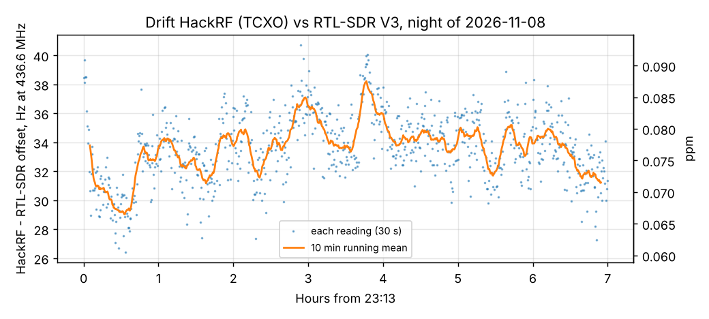

# Drift HackRF vs RTL-SDR, 7 h night run

2026-11-08 23:13 - 2026-11-09 06:13, one reading every 30 s (840). HackRF One (TCXO) CW at 436.6 MHz,
-100 dBm at the LNA input, through 30+30+10 dB and 1 m coax -> Spacewalker LNA -> RTL-SDR V3 (black, its
own crystal, ppm -0.2 set in the app) -> Mi 10. The offset is HackRF minus RTL as the phone measures it, so it
is the sum of both oscillators' errors. Nothing else ran on the lab PC this time (the
[second night](../2026-11-07_2354_drift-hackrf-night2/report.md) was spoiled by stale scheduled tasks).

| | This night | [First night](../2026-11-07_0356_drift-hackrf-night/report.md) |
|---|---|---|
| Readings | 839 of 840 | 600 |
| Median offset | **+33.6 Hz** (+0.077 ppm) | +33.4 Hz |
| Peak to peak | 14.3 Hz | 12.3 Hz |
| 5-95 % spread | 7.6 Hz | - |
| Linear trend | +0.2 Hz/h | - |

- The two nights agree within 0.2 Hz: the pair is stable to about 0.08 ppm from day to day, and the app's
  ppm correction (-0.2) can stay as it is.
- Within the night the offset wanders slowly by a few Hz (hourly medians 31.1 ... 35.5 Hz), most likely room
  temperature acting on the RTL's crystal; reading to reading scatter is about 2.4 Hz (1 sigma).
- For decoding this is negligible: 14 Hz is a fraction of the CW tracker's window and of a 9k6 FSK channel,
  and far below satellite Doppler.
- One reading (t = 875 s) lost the carrier (SNR 1 dB, -948 Hz) and is left out; one more had a lower SNR
  (44.7 dB) but a normal offset.
