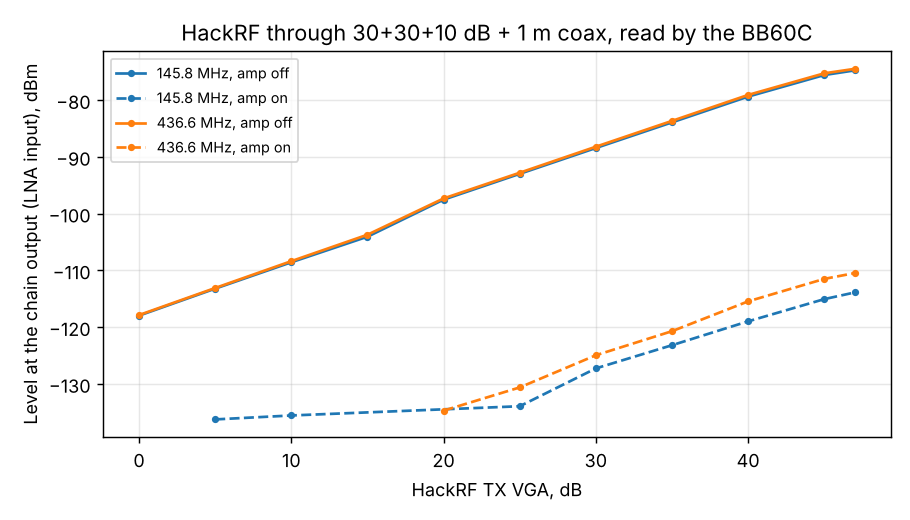

# HackRF calibrated on the BB60C (home chain), and what it changes

2026-11-09 10:05-10:23, G7 laptop. The home lab chain brought to the lab unchanged: 30+30+10 dB attenuators
and the 1 m coax. HackRF One (TCXO, firmware 2026.01.3, libhackrf 2026.01.3 via SoapySDR, `hackrf_server.py`).

1. **Chain loss** ([path cal](../2026-11-09_1007_path-cal-hackrf-chain/results.json), VSG60 0 dBm -> chain ->
   BB60C): 69.6 dB at 145 MHz, **72.8 dB at 435-438 MHz** (72.5-73.1), 73.9 dB at 500 MHz. The 70.5 dB used
   at home was a guess from the receiver; the pads and coax lose 2.3 dB more on 70 cm.
2. **HackRF output** (`hackrf_cal.py --atten 72.8`, CW at full digital scale, TX VGA 0-47, amp off/on):

| | 145.8 MHz | 436.6 MHz |
|---|---|---|
| Level at the chain output, TX VGA 0 | -118.2 dBm | **-118.1 dBm** |
| HackRF output, TX VGA 0 (P0) | -48.6 dBm | -45.3 dBm |
| TX VGA law (0-30 dB) | 1.00 dB/dB, +-0.8 dB | 1.00 dB/dB, +-0.7 dB |
| Maximum (TX VGA 47, amp off) | -2.0 dBm | -1.7 dBm |
| RF amplifier on | 22-24 dB **less** | 22-24 dB **less** |
| LO leakage at the tone's level | -18 dBc at VGA 0, -38 dBc at VGA 20 | same |

- Frequency: **-0.80 ppm** against the BB60C (the VSG60 reads +0.11 ppm against it); 10 minutes after the
  start the output was stable to 0.2 dB and 20 Hz.
- The amplifier is broken (the earlier receiver calibration saw the same); `allow_amp` stays off.
- LO leakage: the tone sits 250 kHz above the LO, so the leakage is outside every channel the tests use;
  at TX VGA 0 it is only 18 dB below the tone, a reason to keep the digital scale high and the VGA low only
  when needed.
- At TX VGA 0 the 144.8, 437 and 438 MHz readings found the LO leakage or noise instead of the tone (frequency
  error of kHz); those points are left out of the fit. 437 MHz reads 1.4 dB low; probably a BB60C reading
  issue, but use 436.6 MHz values for 70 cm.

`tools/lab/hackrf_cal.json` is rewritten from this run: P0 per frequency (median of level - TX VGA over
TX VGA 0-30), `atten_db` 72.8, ppm -0.80. **Use `--atten 72.8` with this chain at every frequency**; P0 - 72.8
is then the level at the LNA input as the BB60C reads it (at 145 MHz the chain loses 69.6 dB, already folded
into P0).

## Correction to the home measurements of 2026-11-07/08

The home runs used the receiver calibration (P0 -45.6 dBm via 70.5 dB, i.e. -116.1 dBm at the LNA input at
TX VGA 0). The BB60C reads -118.1 dBm for that setting. Replaying the settings those runs used through this
table: **every HackRF level in those reports is 1.8-2.1 dB too high**; the signal at the LNA was weaker, so
the sensitivities were better than reported:

| Result | Reported | Corrected |
|---|---|---|
| APRS 1200, 90 % ([beta 12](../2026-11-07_2336_aprs-beta12/report.md)) | -119.3 dBm | about -121.1 dBm |
| 9k6 G3RUH 3 kHz dev, 90 % ([beta 12](../2026-11-07_2253_g3ruh-beta12/report.md)) | -114.7 dBm | about -116.6 dBm |
| 9k6 G3RUH 4.5 kHz dev | -117.1 dBm | about -118.9 dBm |
| CW Doppler levels -130/-135/-138 ([lab2](../2026-11-08_1421_doppler-hackrf-lab2-fresh/report.md)) | as named | -131.8/-136.8/-139.8 dBm |

The C/N0 values the phone measured (39/35/32.5 dB-Hz) do not change. The receiver calibration went wrong
by about 2 dB because it took the phone's dBFS scale from system A in the lab, which used another RTL-SDR;
the two dongles' gains differ by about that much. With the corrected levels the home APRS result is within
about 1.4 dB of the lab's -122.5 dBm, and the home noise floor was 2.9 dB higher: consistent.
