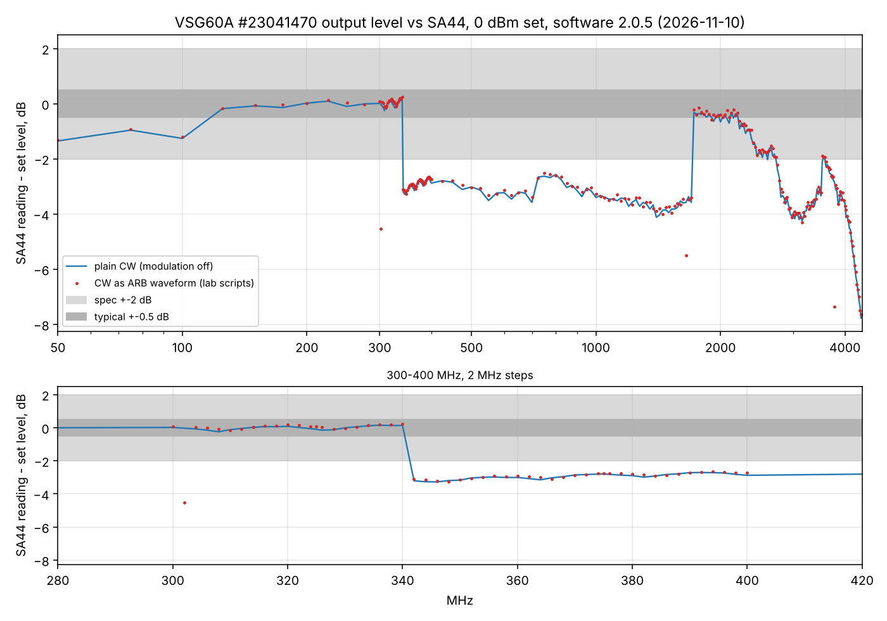

# VSG60A output level swept against the SA44 (software 2.0.5)

2026-11-10 10:48-11:20, G7. VSG60A (serial 23041470) -> SMA adapter - 100 pF DC block - SMA adapter ->
SA44 (serial 30300380). VSG application **2.0.5** (installed just before). Set level 0 dBm, SA44 reference
+5 dBm, 100 Hz RBW, peak within +-10 kHz. 50-4375 MHz in 25 MHz steps plus 300-400 MHz in 2 MHz steps;
plain CW (modulation off, [this folder](results.json)) and CW played as an ARB waveform, as the lab scripts
do ([run](../2026-11-10_1048_vsg60a-sweep-sa44-sw205/results.json)).

| Band | Reading - set (CW) | |
|---|---|---|
| 50-100 MHz | -0.9 ... -1.4 dB | DC block (100 pF) costs ~0.4 dB at 50 MHz |
| 125-340 MHz | **-0.2 ... +0.2 dB** | in the typical spec |
| **342-1700 MHz** | **-2.6 ... -4.1 dB** (median -3.0 up to 1 GHz, -3.5 above) | outside the +-2 dB spec |
| 1725-2200 MHz | -0.3 ... -0.7 dB | in spec |
| 2.2-3.6 GHz | -1 ... -4 dB, wavy | partly outside |
| 3.6-4.4 GHz | -2 ... -7.8 dB | SA44 near the top of its range; read with care |

- The level falls by **3.3 dB between 340 and 342 MHz** and comes back by 3.2 dB between 1700 and 1725 MHz:
  two sharp edges, flat in between. That is one hardware band (filter or LO range, the edges are a factor of 5
  apart) whose stored correction is about 3 dB off, not a slow roll-off or a cable problem.
- ARB and plain CW agree (median difference 0.06 dB; three single ARB points read low, settling): the new
  software's ARB scaling fix is not involved, and software 2.0.5 did not change the result.
- The BB60C saw the same (+2.6 dB at 436.6 MHz, +3.2 dB at 1 GHz, 3.8 dB step between 325 and 350 MHz), so
  two independent analyzers agree.

**Recommendation:** report it to Signal Hound support (unit 23041470, data above) and ask for a recalibration
or a corrected correction table; until then, add +3.0 dB (342-1000 MHz) / +3.5 dB (1-1.7 GHz) to VSG60A set
levels used without a BB60C path calibration. Measurements in this repo that used `path_cal.py` are not affected.
