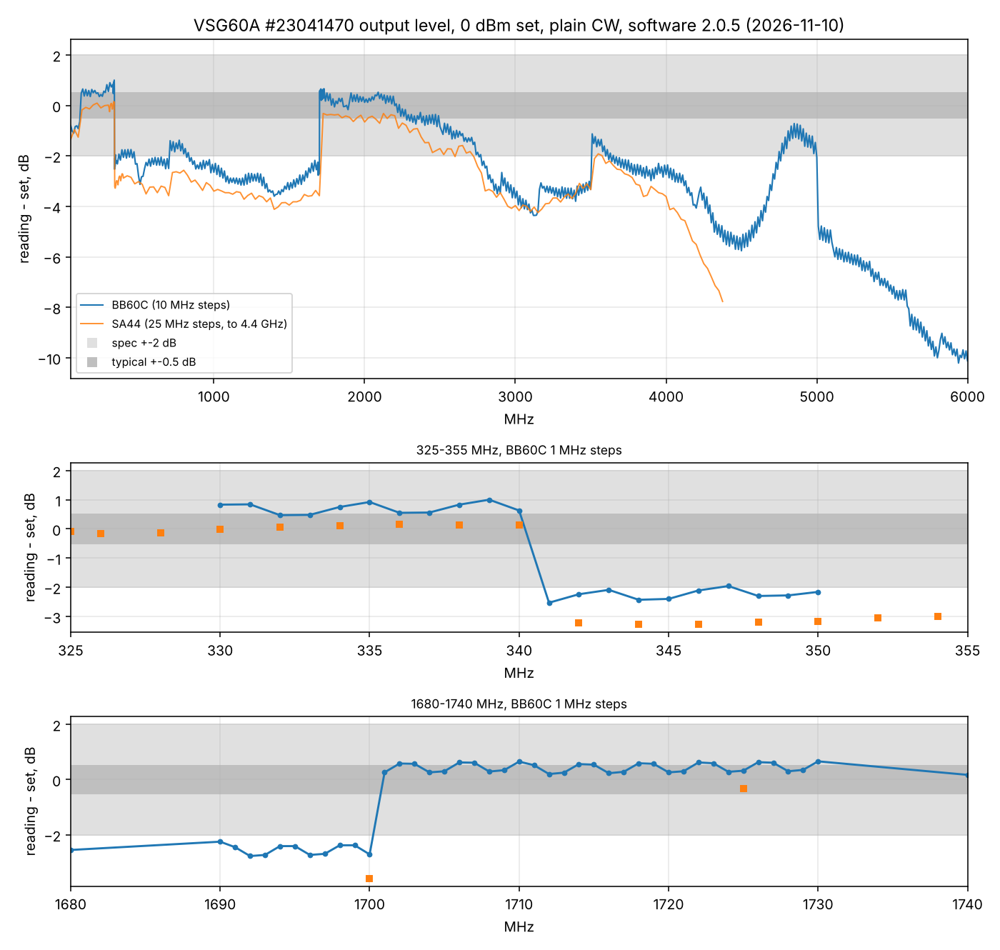

# VSG60A output level swept against the BB60C to 6 GHz (software 2.0.5)

2026-11-10 11:32-11:55, G7. VSG60A (serial 23041470) -> SMA adapter - 100 pF DC block - SMA adapter ->
BB60C. VSG application 2.0.5, plain CW (modulation off), set level 0 dBm, BB60C reference +5 dBm, 100 Hz
RBW. 50-6000 MHz in 10 MHz steps, 330-350 and 1690-1730 MHz in 1 MHz steps (650 points). Three points
(2510, 4210, 5110 MHz) where the BB60C missed the tone are left out. The orange curve is the
[SA44 sweep](../2026-11-10_1110_vsg60a-sweep-sa44-sw205-cw/report.md) of an hour earlier.

| Band | BB60C reading - set, median (range) |
|---|---|
| 50-110 MHz | -0.8 dB (DC block ~0.4 dB at 50 MHz) |
| 120-340 MHz | +0.6 dB (+0.4 ... +1.0) |
| **341-700 MHz** | **-2.4 dB** (-1.4 ... -3.1) |
| **710-1700 MHz** | **-2.8 dB** (-1.4 ... -3.6) |
| 1701-2200 MHz | +0.3 dB (-0.2 ... +0.7) |
| 2.2-3.0 GHz | -1.2 dB, falling to -3.7 |
| 3.0-3.5 GHz | -3.3 dB |
| 3.51-5.0 GHz | -2.6 dB, a dip to -5.8 at 4.5 GHz, back to -0.7 at 4.85 GHz |
| **5.01-6.0 GHz** | **-6 ... -10 dB** |

Level steps between neighbouring points (larger than 0.9 dB):

| Between | Step |
|---|---|
| 340 / **341 MHz** | -3.2 dB |
| 700 / 710 MHz | +1.1 dB |
| 1700 / **1701 MHz** | +3.0 dB |
| 3500 / 3510 MHz | +2.2 dB |
| 5000 / 5010 MHz | -2.7 dB |

- The 341 and 1701 MHz edges are exact to 1 MHz and both analyzers see them (BB60C -3.2 / +3.0 dB, SA44
  -3.3 / +3.2 dB). Between them the VSG60A is 2.4-3.6 dB low; outside, near 0. A band whose stored
  correction is wrong, not a slow roll-off.
- Above 5 GHz the output falls to -10 dB at 6 GHz (the brochure specifies +-2 dB to 6 GHz).
- A fine ripple of +-0.2 dB repeating every 4 MHz runs across the whole range (visible in the 1 MHz steps).
- The BB60C reads 0.7 dB higher than the SA44 on average below 3.6 GHz (5-95 %: +0.1 ... +1.1 dB); both are
  within their own +-2 dB specs of each other, and they agree on the shape.

**Conclusion:** VSG60A 23041470 is outside its amplitude specification from 341 to 1700 MHz (-3 dB) and
above 5 GHz (to -10 dB), with software 2.0.5 as with the earlier one; it needs Signal Hound's attention
(recalibration or a new correction table). Until then use it only through `path_cal.py` paths (the lab's
standard), or add the table above to the set level.
