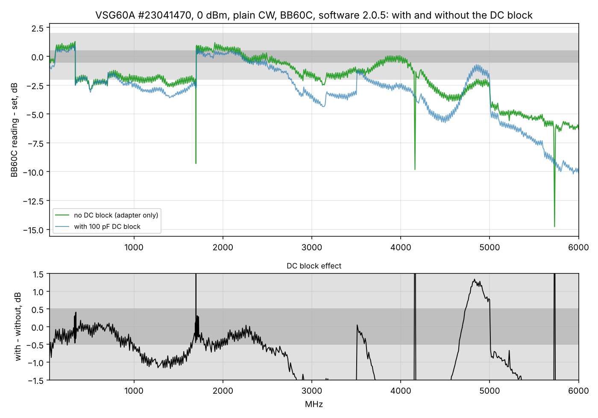

# VSG60A swept against the BB60C without the DC block

2026-11-10 11:55-12:15, G7. Same as the [11:32 sweep](../2026-11-10_1132_vsg60a-sweep-bb60c-sw205-cw/report.md)
(VSG60A 23041470, software 2.0.5, plain CW 0 dBm, BB60C, 650 points) but **without the 100 pF DC block**:
VSG60A -> SMA adapter -> BB60C.

| Band | Without block, median | With block - without |
|---|---|---|
| 50-100 MHz | -0.2 dB | -0.6 dB |
| 100-340 MHz | +0.7 dB | -0.2 dB |
| **341-1700 MHz** | **-2.1 dB** (to -2.6) | -0.4 dB (up to -1.1 at 1-1.6 GHz) |
| 1701-3000 MHz | +0.2 dB | -0.4 dB, growing above 2.6 GHz |
| 3-6 GHz | -2.5 dB (0 dB at 3.8-4 GHz, -4 ... -6.5 dB above 5 GHz) | -1 ... -4 dB |

- **The steps are the VSG60A's, not the DC block's:** 340/341 MHz -3.0 dB and 1700/1701 MHz +3.1 dB, the same
  as with the block. Smaller ones at 705, 2905 and 5005 MHz.
- **The DC block is poor above 1 GHz:** about 1 dB at 1-1.6 GHz and 1-4 dB from 2.7 GHz up; it explains part of
  the high-frequency fall in the earlier sweeps (and in the SA44 sweep, which also had it).
- Without the block the VSG60A is still out of its +-2 dB spec in 341-1700 MHz (median -2.1 dB, worst -2.6 dB)
  and above 5 GHz (-4 ... -6.5 dB).
- Three single points (1697, 4160, 5730 MHz) read 7-9 dB low: BB60C misreads at those exact frequencies,
  not the VSG.
- **The HackRF #1 calibration of 2026-11-09 was made through this DC block**: its levels above ~1 GHz are low
  by the block's loss (about 1 dB at 1-1.6 GHz, up to ~4 dB at 6 GHz). Corrected in z2labs/hackrf_calibrations.
